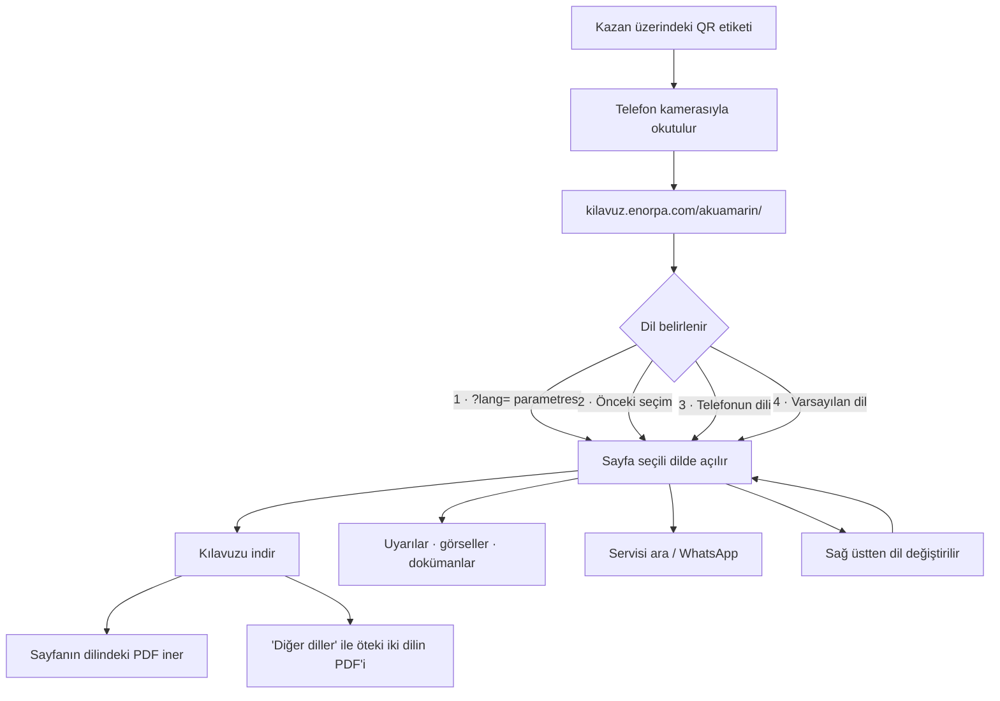

# ENORPA QR Kullanım Kılavuzu Sistemi — Ana Şablon

| Alan | Değer |
|---|---|
| **Belge** | `KILAVUZ_SABLONU.md` |
| **Şablon sürümü** | 1.1 — 20.11.2026 (PDF kılavuz üç dilde: TR, EN, RU) |
| **Proje sahibi** | Ferhat Hacıosmanoğlu (ENORPA Enerji, Mekatronik Mühendisi) |
| **İlk uygulama** | Akuamarin kazanı → Bölüm 14 |
| **Durum** | Taslak: render görselleri ve açık kararlar bekleniyor → Bölüm 15 |

Kazanın üzerindeki QR kod okutulduğunda açılan üç dilli (TR / EN / RU) ürün sayfasının ve indirilebilir PDF kullanım kılavuzunun **tek kaynak belgesi**. Akuamarin için hazırlandı; diğer ENORPA serileri aynı klasör yapısı, aynı içerik dosyası ve aynı adımlarla eklenir.

## İçindekiler

0. Bu dosya nasıl kullanılır
1. Proje özeti
2. Seri kayıt tablosu
3. Mimari ve klasör yapısı
4. Sayfa tasarımı
5. Dil sistemi ve sağ üst dil butonu
6. İçerik dosyası: `urun.js`
7. Render görselleri
8. PDF kullanım kılavuzu şablonu
9. QR kod ve etiket
10. Yayın (barındırma)
11. Yeni kazan ekleme prosedürü
12. Claude Code için hazır komutlar
13. Test ve kabul kriterleri
14. Akuamarin ürün kartı
15. Açık kararlar
16. Yol haritası

**Ekler:** A Arayüz metinleri · B Teknik terim sözlüğü · C Birimler · D Komut kartı · E Değişiklik günlüğü

---

## 0. Bu dosya nasıl kullanılır

### 0.1 Amaç

Bu belge üç iş görür:

1. **Şartname:** Siteyi kuracak kişiye (Claude Code veya bir geliştirici) neyin nasıl yapılacağını tarif eder.
2. **Şablon:** Yeni bir kazan için doldurulacak alanları, klasörleri ve kılavuz bölümlerini tanımlar.
3. **Kayıt:** Serilerin durumunu, açık kararları ve şablon değişikliklerini tutar.

### 0.2 İşaretler

| İşaret | Anlamı | Ne yapılır |
|---|---|---|
| `{{ALAN_ADI}}` | Doldurulacak yer tutucu | Kaynak belgeden doldurulur; yayından önce hiçbiri kalmaz |
| `⚠️ DOĞRULANACAK` | Değer var ama kaynağı zayıf (web sayfası, eski belge) | Teknik föy, çizim, CE belgesi veya isim plakasıyla teyit edilir |
| `🟡 K-xx` | Açık karar | Bölüm 15'teki tabloda karara bağlanır |
| `[ÖNERİ]` | Bu belgenin önerisi, henüz onaylanmadı | Onaylanınca işaret silinir |
| `{boyut}` (tek süslü) | Çalışma anında doldurulan değişken | Kod doldurur; elle dokunulmaz |

### 0.3 Claude Code ile kullanım

1. Bu dosyayı repo köküne `KILAVUZ_SABLONU.md` adıyla koy.
2. Repo köküne aşağıdaki kısa `CLAUDE.md` dosyasını ekle. Uzun belge her oturumda baştan yüklenmez, gerektiğinde ilgili bölüm okunur.

```markdown
# ENORPA Kılavuz Sitesi — Claude Code kuralları
- Her işe başlamadan önce KILAVUZ_SABLONU.md'nin ilgili bölümünü oku ve ona uy.
- Teknik değer uydurma. Kaynakta olmayan her değeri {{...}} olarak bırak.
- Tüm kullanıcı metinleri { tr, en, ru } üçlüsüdür; TR ana kaynaktır.
- Kullanım kılavuzu PDF'i de üç dildedir (TR, EN, RU): üç ayrı dosya, aynı içerik, aynı revizyon (Bölüm 8.11).
- Site saf HTML/CSS/JS kalır: framework, CDN, derleme adımı ekleme.
- Seriye özel içerik yalnızca <seri>/urun.js içinde olur; ortak/ klasörüne ürün metni yazma.
- İş bitince Bölüm 13'teki kabul listesini çalıştır ve sonucu raporla.
```

3. Hazır komutlar Bölüm 12'dedir.

### 0.4 Altın kurallar

1. **Teknik değer uydurulmaz.** Her sayı teknik föy, çizim, CE belgesi veya isim plakasından gelir ve `kaynak` alanına yazılır.
2. **Sayfa da PDF de üç dildedir.** Türkçe ana dildir; EN ve RU, onaylı TR metinden çevrilir. Kullanım kılavuzu TR, EN ve RU olarak üç ayrı PDF'tir; üçünün içeriği ve revizyonu aynıdır, bir dil eksikse seri yayına alınmaz. Güvenlik metinleri teknik onay ve çevirmen onayı olmadan yayınlanmaz.
3. **Basılı QR'daki adres asla değişmez.** Site taşınırsa eski adres yönlendirilir; etiket yeniden basılmaz.
4. **İçerik tek dosyadadır.** Bir serinin bütün metinleri `urun.js` içindedir; HTML/CSS/JS dosyalarında seriye özel metin olmaz.
5. **Ortak kod tek yerdedir.** `ortak/` klasöründe yapılan bir düzeltme bütün kazanlara aynı anda yansır.
6. **Dış bağımlılık yoktur.** Framework, CDN ve harici font servisi kullanılmaz. Kazan sahada uzun yıllar kalır; sayfa da 10 yıl sonra sorunsuz açılmalıdır.
7. **Kazan dairesi koşulu esastır.** Sayfa bodrum katta zayıf çekimde, tek elle ve iş eldiveniyle kullanılabilmelidir: hafif sayfa, büyük butonlar.
8. **Taslak belli olur.** `durum: "taslak"` olan sayfa arama motorlarına kapalıdır ve üstünde TASLAK şeridi görünür.

---

## 1. Proje özeti

### 1.1 Ne yapıyoruz

Her kazanın üzerinde (kontrol panosu kapağında veya isim plakasının yanında) bir QR etiketi bulunur. Okutulunca o serinin mobil sayfası açılır ve kullanım kılavuzu PDF'i tek dokunuşla indirilir. Referans, Yurtfan fanlarındaki QR → sayfa → PDF düzenidir. Bu proje o akışı şunlarla genişletir:

- Sağ üstte modern **TR / EN / RU** dil seçici: sayfa metinleri ve PDF bağlantısı birlikte değişir
- **Üç dilde PDF kılavuz:** TR, EN ve RU için ayrı ama içeriği birebir aynı PDF; ana buton sayfanın dilindeki PDF'i indirir, öteki iki dil hemen altından indirilebilir
- Yüksek kaliteli **render görselleri** ve yakınlaştırılabilir galeri
- Kısa **güvenlik uyarıları**, **doküman listesi** ve tek dokunuşla **servis iletişimi**
- Bütün seriler için **tek şablon**: yeni kazan = yeni klasör + içerik dosyası

### 1.2 Kim kullanacak

| Kullanıcı | Ortam | Sayfadan beklentisi |
|---|---|---|
| İşletme / kazan operatörü | Kazan dairesi, telefon | Kılavuzu hemen açmak, uyarıları görmek, servisi aramak |
| Servis / montaj teknisyeni | Saha, çoğu zaman eldivenli | Teknik veri, çizim ve devreye alma bilgisine hızlı erişim |
| Yurt dışı müşteri / distribütör | Çoğunlukla RU veya EN | Kendi dilinde sayfa ve kılavuz |
| ENORPA ekibi | Ofis ve saha | Güncel kılavuzu müşteriye bağlantıyla göndermek |

### 1.3 Kapsam

**Kapsamda:** seri sayfaları, kılavuz merkezi (bütün serilerin listesi), üç dilde PDF kılavuzlar (TR, EN, RU), QR etiketleri, yayın ve güncelleme süreci.

**Kapsam dışı (Faz 1):** kullanıcı hesabı, online form, seri numarasına özel kayıt, fiyat ve satış bilgisi. Bunlar Faz 3 adaylarıdır (Bölüm 16).

### 1.4 Kullanıcı akışı



---

## 2. Seri kayıt tablosu

### 2.1 Seriler ve kılavuz modülleri

> Seri tanımları ENORPA'nın İSİB ve DirectIndustry'deki ürün sayfalarından derlendi. ⚠️ Teknik ekip doğrulayacak; eksik seri varsa eklenecek.

| Seri | Klasör (slug) | Tür (web'deki tanım) | Yakıt (web'deki tanım) | Kılavuz modülleri [ÖNERİ] |
|---|---|---|---|---|
| Akuamarin | `akuamarin` | 3 geçişli, alev-duman borulu (Scotch tipi) sıcak su kazanı | Sıvı / gaz | BR |
| Akuamarin KS | `akuamarin-ks` | 3 geçişli, alev-duman borulu kızgın su kazanı | Sıvı / gaz | BR + KS |
| Turkuaz | `turkuaz` | Kompakt sıcak su kazanı | Katı ⚠️ (bir kaynakta "gaz / kömür") | KY |
| Turkuaz KS | `turkuaz-ks` | Katı yakıtlı kızgın su kazanı | Katı | KY + KS |
| Oniks | `oniks` | Hareketli ızgaralı, PLC kontrollü sıcak su kazanı | Katı | KY |
| Kuvars | `kuvars` | Tek/çift ocaklı, tek/çift stokerli buhar kazanı | Katı | KY + BH |
| Kuvars NG | `kuvars-ng` | 3 geçişli buhar kazanı | ⚠️ doğrulanacak | BR + BH ⚠️ |
| Turmalin | `turmalin` | 4 geçişli buhar kazanı | Çok yakıtlı | KY / BR + BH ⚠️ |
| Ametrin | `ametrin` | Hidrolik itmeli ızgaralı, PLC kontrollü buhar kazanı | Katı | KY + BH |
| Jasper | `jasper` | Su borulu, düşük su hacimli buhar jeneratörü (TS EN 12952) | ⚠️ doğrulanacak | SB (+ BR ⚠️) |
| Kalsedon | `kalsedon` | ⚠️ Katalog adı var, türü doğrulanacak | ⚠️ | ⚠️ |

**Modül kodları** (ayrıntı Bölüm 8.4): **BR** brülörlü (sıvı/gaz yakıt) · **KY** katı yakıt · **BH** buhar · **KS** kızgın su · **SB** su borulu buhar jeneratörü.

### 2.2 Seri renkleri ve belge kodları

ENORPA serileri değerli taş adları taşır; her seri sayfasında kendi taşının rengi **vurgu rengi** olarak kullanılır. Logo ve üst bar ENORPA marka renginde kalır, vurgu rengi yalnızca ürün öğelerinde (ana buton, seçili dil, başlık çizgileri) görünür.

| Seri | Belge kodu | Vurgu rengi [ÖNERİ] | Açık ton | Beyaz metin kontrastı |
|---|---|---|---|---|
| Akuamarin / Akuamarin KS | AKU / AKS | `#0E6E8C` deniz mavisi | `#E3F1F5` | 5,8 : 1 |
| Turkuaz / Turkuaz KS | TRK / TKS | `#0B7A6F` turkuaz yeşili | `#E2F2EF` | 5,2 : 1 |
| Oniks | ONK | `#2B2F36` antrasit | `#ECEDEF` | 13,4 : 1 |
| Kuvars / Kuvars NG | KVR / KNG | `#6B5B4E` dumanlı kuvars | `#F0EDEA` | 6,5 : 1 |
| Turmalin | TRM | `#2E6B3F` turmalin yeşili | `#E6F0E9` | 6,4 : 1 |
| Ametrin | AMT | `#6B3FA0` ametist moru | `#F0EBF6` | 7,4 : 1 |
| Jasper | JSP | `#9A3B2E` kırmızı jasper | `#F5EAE8` | 6,9 : 1 |
| Kalsedon | KLS | `#5A5FA8` lavanta mavisi | `#ECEDF6` | 5,8 : 1 |

- Kural: vurgu rengi üzerindeki beyaz metnin kontrastı **en az 4,5 : 1** olur (WCAG AA). `kontrol.mjs` bunu denetler.
- Varyantlar (KS, NG) ana serinin rengini kullanır; adın yanında küçük bir rozet olarak görünür.
- ENORPA marka rengi: `{{ENORPA_ANA_RENK}}` (logo SVG dosyasından alınır).

---

## 3. Mimari ve klasör yapısı

### 3.1 Teknoloji kararları

| Karar | Gerekçe |
|---|---|
| Saf HTML + CSS + JavaScript, framework yok | Uzun ömür, sıfır bakım, her yerde barındırılabilir |
| İçerik `urun.js` dosyasında (`window.URUN = {...}`) | JSON'dan farkı: dosya bilgisayarda çift tıklanınca da açılır (`file://` engeline takılmaz) ve içine açıklama satırı yazılabilir |
| Statik barındırma (GitHub Pages önerilir) | Ücretsiz, HTTPS, git ile sürüm geçmişi (Bölüm 10) |
| Derleme adımı yok, yalnızca yardımcı betikler (`araclar/`) | Görsel ve QR üretimi yerel bilgisayarda yapılır, çıktılar siteye konur |
| Sistem yazı tipi (varsayılan) | Sıfır indirme; Türkçe ve Kiril karakterlerin tamamı hazır |

### 3.2 Klasör ağacı

```text
enorpa-kilavuz/                      ← yayın reposu (GitHub Pages)
├── index.html                       ← Kılavuz merkezi: bütün seriler
├── 404.html                         ← Dili algılayan "sayfa bulunamadı"
├── .nojekyll                        ← Jekyll işlemesini kapatır, dosyalar olduğu gibi sunulur
├── .gitignore                       ← */gorsel/kaynak/ ve node_modules/ dışarıda kalır
├── CNAME                            ← kilavuz.enorpa.com (özel alan adıyla, 🟡 K-01)
├── robots.txt                       ← /araclar/ ve /_sablon/ taranmaz
├── KILAVUZ_SABLONU.md               ← bu belge
├── CLAUDE.md                        ← Claude Code için kısa kurallar (Bölüm 0.3)
├── package.json                     ← yalnızca araclar/ betikleri için (sharp, qrcode)
│
├── ortak/                           ← BÜTÜN serilerin paylaştığı dosyalar
│   ├── css/stil.css
│   ├── js/
│   │   ├── kilavuz.js               ← sayfa çizimi, dil sistemi, galeri
│   │   ├── metinler.js              ← arayüz metinleri + birimler (Ek A, Ek C)
│   │   ├── uyarilar.js              ← onaylı standart güvenlik uyarıları (Bölüm 8.7)
│   │   └── seriler.js               ← kılavuz merkezindeki seri listesi (Bölüm 2)
│   └── img/
│       ├── enorpa-logo.svg
│       ├── favicon.svg
│       └── ikonlar.svg              ← SVG sembol seti (Bölüm 4.6)
│
├── akuamarin/                       ← bir seri = bir klasör = bir adres
│   ├── index.html                   ← kabuk dosya; yalnızca 6 meta satırı seriye özel
│   ├── urun.js                      ← serinin BÜTÜN içeriği (Bölüm 6)
│   ├── gorsel/
│   │   ├── kaynak/                  ← orijinal render PNG'ler (repoya girmez)
│   │   ├── akuamarin-on-640.avif … akuamarin-on-2400.jpg
│   │   └── akuamarin-paylasim.jpg   ← 1200×630, WhatsApp/Telegram önizlemesi
│   ├── pdf/
│   │   ├── kilavuz-tr.pdf           ← Türkçe   ┐ üçü zorunlu; içerik ve revizyon aynı;
│   │   ├── kilavuz-en.pdf           ← İngilizce│ adları revizyonda değişmez
│   │   ├── kilavuz-ru.pdf           ← Rusça    ┘ (Bölüm 8.11)
│   │   ├── ce-uygunluk.pdf          ← 🟡 K-05
│   │   └── arsiv/                   ← eski revizyonlar (…_TR_Rev01.pdf · …_EN_Rev01.pdf · …_RU_Rev01.pdf)
│   └── qr/
│       ├── akuamarin-qr.svg
│       ├── akuamarin-qr.png
│       └── akuamarin-etiket.pdf
│
├── _sablon/                         ← yeni seri için kopyalanacak boş klasör
│   ├── index.html
│   └── urun.js
│
└── araclar/                         ← yerelde çalışan yardımcı betikler
    ├── gorsel-hazirla.mjs           ← render → AVIF / WebP / JPG (Bölüm 7.7)
    ├── qr-uret.mjs                  ← QR SVG / PNG (Bölüm 9.5)
    ├── pdf-karsilastir.mjs          ← üç dilin PDF'lerini karşılaştırır (Bölüm 8.11)
    └── kontrol.mjs                  ← eksik çeviri, kırık bağlantı, bütçe denetimi (Bölüm 13)
```

### 3.3 Dosya sorumlulukları

| Dosya | Kim düzenler | İçerik | Seriye özel mi |
|---|---|---|---|
| `ortak/css/stil.css` | Geliştirici | Bütün görünüm | Hayır |
| `ortak/js/kilavuz.js` | Geliştirici | Sayfa çizimi, dil sistemi, galeri, PDF bağlantıları | Hayır |
| `ortak/js/metinler.js` | Geliştirici / çevirmen | Arayüz metinleri (Ek A), birimler (Ek C) | Hayır |
| `ortak/js/uyarilar.js` | Teknik sorumlu / çevirmen | Onaylı standart uyarılar G1–G7 (Bölüm 8.7) | Hayır |
| `ortak/js/seriler.js` | İçerik sorumlusu | Kılavuz merkezindeki seri kartları | Liste |
| `<seri>/urun.js` | İçerik sorumlusu | Serinin bütün içeriği | Evet |
| `<seri>/index.html` | Şablondan kopyalanır | Yalnızca 6 meta satırı değişir | Kısmen |

### 3.4 Adlandırma kuralları

| Öğe | Kural | Örnek |
|---|---|---|
| Klasör (slug) | Küçük harf, Türkçe karakter yok (ç→c, ğ→g, ı→i, ö→o, ş→s, ü→u), boşluk yerine `-` | `akuamarin-ks` |
| Görsel | `{slug}-{görünüm}-{genişlik}.{uzantı}` | `akuamarin-on-1600.webp` |
| PDF (adres) | `pdf/kilavuz-{dil}.pdf`; revizyonda adı değişmez | `pdf/kilavuz-ru.pdf` |
| PDF (indirilen ad) | `ENORPA_{Seri}_{BelgeAdı}_{DİL}_Rev{NN}.pdf`; belge adı o dilde yazılır | `ENORPA_Akuamarin_Kullanim_Kilavuzu_TR_Rev01.pdf` · `ENORPA_Akuamarin_User_Manual_EN_Rev01.pdf` · `ENORPA_Akuamarin_Rukovodstvo_RU_Rev01.pdf` |
| Belge numarası | `ENR-KLV-{SERİ KODU}-{DİL}` + `Rev.NN`; üç dilin revizyonu hep aynıdır | `ENR-KLV-AKU-TR` · `ENR-KLV-AKU-EN` · `ENR-KLV-AKU-RU` (Rev.01) |
| QR dosyaları | `{slug}-qr.{svg,png}`, `{slug}-etiket.pdf` | `akuamarin-qr.svg` |
| Tarih | ISO biçimi `YYYY-AA` veya `YYYY-AA-GG` | `2026-11` |

> İndirilen dosya adı bağlantıdaki `download` özniteliğiyle verilir. Böylece adres kısa ve sabit kalır (`kilavuz-tr.pdf`), kullanıcının telefonuna ise açıklayıcı adla iner.

---

## 4. Sayfa tasarımı

### 4.1 Bölüm sırası ve mobil tel çerçeve

1. **Üst bar** (yapışkan, cam efekti): solda ENORPA logosu (kılavuz merkezine gider), sağ üstte dil seçici
2. **Hero:** render, tür satırı, seri adı, kısa slogan, **ana buton: Kılavuzu İndir** (sayfanın dilindeki PDF), altında "Diğer diller" satırı (öteki iki dilin PDF'i), ikincil butonlar: Online Görüntüle, Paylaş
3. **Özet bilgiler:** 4–6 çip
4. **Güvenlik uyarıları:** en fazla 5 madde, sinyal kelimeli
5. **Galeri:** yatay kaydırmalı, dokununca büyür
6. **Dokümanlar:** kılavuz, CE belgesi, çizim, şema…; her belgenin yanında dil rozetleri (TR · EN · RU), her rozet o dilin dosyasını doğrudan indirir
7. **Hızlı başlangıç** (opsiyonel)
8. **Sık sorulan sorular** (opsiyonel, açılır-kapanır)
9. **Servis ve iletişim:** Ara / WhatsApp / E-posta / Yol tarifi + "seri numaranız isim plakasında" notu
10. **Alt bilgi:** üretici unvanı, şehir, telif, sayfa sürümü

```text
┌──────────────────────────────────────┐
│ ENORPA                ◍ ( TR│EN│RU )  │  ← yapışkan cam üst bar
├──────────────────────────────────────┤
│                                      │
│          [  RENDER — ön 3/4  ]       │  ← açık vurgu tonunda radyal zemin,
│                                      │     yumuşak zemin gölgesi
│  SICAK SU KAZANI                     │  ← tür satırı (vurgu rengi, küçük)
│  Akuamarin                           │  ← h1, seri adı
│  {{slogan}}                          │
│ ┌──────────────────────────────────┐ │
│ │ ↓  Kullanım Kılavuzunu İndir     │ │  ← ANA BUTON (vurgu rengi)
│ │    PDF · 4,2 MB · Rev.01         │ │
│ └──────────────────────────────────┘ │
│   Diğer diller:  English · Русский   │  ← öteki iki dilin PDF'i
│ [ ◉ Online görüntüle ] [ ⇪ Paylaş ]  │  ← ikincil butonlar
├──────────────────────────────────────┤
│ ┌───────────────┐ ┌───────────────┐  │
│ │ Kapasite      │ │ İşletme bas.  │  │  ← özet çipler (2 sütun)
│ │ 75–20.000 kW  │ │ 1–15 bar(g)   │  │
│ └───────────────┘ └───────────────┘  │
├──────────────────────────────────────┤
│ ▌TEHLİKE  Gaz kokusu alırsanız …     │  ← güvenlik (en fazla 5)
│ ▌UYARI    Montaj ve bakım yalnızca … │
├──────────────────────────────────────┤
│ ◀  [ görsel 2 / 5 ]  ▶   • ○ • • •   │  ← galeri
├──────────────────────────────────────┤
│ Dokümanlar                           │
│ ▤ Kullanım Kılavuzu    TR · EN · RU  │
│ ▤ CE Uygunluk Beyanı   TR            │
├──────────────────────────────────────┤
│ Servis ve İletişim                   │
│ [ ☎ Ara ] [ WhatsApp ] [ ✉ E-posta ] │
│ Seri numaranız isim plakasındadır.   │
├──────────────────────────────────────┤
│ ENORPA ENERJİ SAN. TİC. LTD. ŞTİ.    │
│ Isparta, Türkiye · © 2026 · v1.0     │
└──────────────────────────────────────┘
```

Çiplerdeki değerler yalnızca tel çerçeve örneğidir; gerçek değerler Bölüm 14'e göre doğrulanır. Gerçek arayüzde semboller yerine SVG ikonlar kullanılır.

### 4.2 Masaüstü yerleşimi (≥ 1024 px)

- Hero iki sütun: görsel solda (%55), metin ve butonlar sağda (%45)
- İçerik en fazla 1120 px genişlikte, ortalı
- Özet çipler 4 sütun, galeri 3 sütunlu ızgara
- Dokümanlar ile servis ve iletişim yan yana

### 4.3 Bileşen ölçüleri

| Bileşen | Mobil | Masaüstü | Not |
|---|---|---|---|
| Üst bar yüksekliği | 56 px | 64 px | Kaydırınca alt gölge belirir |
| Logo | 24 px yükseklik | 28 px | SVG |
| Dil seçici | 36 px yükseklik, segment ≥ 44 px genişlik | Aynı | Bölüm 5.3 |
| Seri adı (h1) | 34 px / 700 | 48 px / 700 | Düz metin; CSS ile büyük harfe çevrilmez (Bölüm 5.8) |
| Tür satırı | 13 px / 600, harf aralığı .08em, vurgu rengi | 14 px | CSS büyük harf kullanılabilir (`lang` doğruysa) |
| Ana buton | Tam genişlik, en az 56 px yükseklik, köşe 16 px | Otomatik genişlik, en az 280 px | İki satır: başlık + "PDF · boyut · Rev." |
| İkincil buton | 48 px, çerçeveli | Aynı | |
| "Diğer diller" satırı | Ana butonun altında, 14 px; öteki iki dil, dilin kendi adıyla (English · Русский) | Aynı | Her bağlantının dokunma alanı ≥ 44 px |
| Özet çip | 2 sütun; etiket 12 px, değer 17 px / 600 | 4 sütun | |
| Uyarı kartı | Sol kenarda 4 px seviye rengi | Aynı | İkon + sinyal kelimesi + metin |
| Doküman satırı | En az 64 px | Aynı | İkon, başlık, meta, dil rozetleri |
| İletişim butonları | 3 eşit buton, 52 px | Aynı | |
| Dokunma alanı | Her etkileşimli öğe ≥ 44 × 44 px | Aynı | Eldivenle kullanım |
| Kenar boşluğu | 16 px | 24–32 px | Çentikli ekranda `env(safe-area-inset-*)` eklenir |

### 4.4 Tasarım değişkenleri (CSS)

```css
:root {
  /* — Marka (bütün seriler) — */
  --enorpa-ana: {{ENORPA_ANA_RENK}};   /* logo SVG dosyasından alınır */
  --metin-1: #0F172A;                  /* başlıklar */
  --metin-2: #475569;                  /* ikincil metin */
  --zemin: #F4F6F8;                    /* sayfa zemini = render zemini */
  --kart: #FFFFFF;
  --cizgi: rgb(15 23 42 / 0.08);

  /* — Seri (kilavuz.js, urun.js'deki renk alanından atar) — */
  --vurgu: #0E6E8C;
  --vurgu-acik: #E3F1F5;

  /* — Uyarı seviyeleri (ANSI Z535 renk mantığı) — */
  --tehlike: #C62828;   /* beyaz metin 5,6 : 1 */
  --uyari:   #BF360C;   /* beyaz metin 5,6 : 1 */
  --dikkat:  #F9A825;   /* üzerinde koyu metin (#1A1A1A) kullanılır */
  --not:     #1565C0;   /* beyaz metin 5,8 : 1 */

  /* — Yazı — */
  --yazi: system-ui, -apple-system, "Segoe UI", Roboto, "Noto Sans",
          "Helvetica Neue", Arial, sans-serif;

  /* — Ölçüler — */
  --r-s: 10px;  --r-m: 16px;  --r-l: 24px;
  --golge-1: 0 1px 2px rgb(0 0 0 / 0.06), 0 6px 20px -10px rgb(0 0 0 / 0.20);
  --golge-2: 0 2px 4px rgb(0 0 0 / 0.06), 0 18px 40px -18px rgb(0 0 0 / 0.30);
  --gecis: 280ms cubic-bezier(0.2, 0.8, 0.2, 1);
}
```

### 4.5 Tipografi

| Öğe | Mobil | Masaüstü | Ağırlık |
|---|---|---|---|
| Seri adı (h1) | 34 px | 48 px | 700 |
| Bölüm başlığı (h2) | 22 px | 28 px | 700 |
| Gövde | 16 px | 17 px | 400 |
| Küçük / meta | 13 px | 13 px | 500 |

- Satır yüksekliği: gövde 1,55; başlık 1,15. Başlıklarda `text-wrap: balance`.
- Gövde metni 16 px'in altına inmez (iOS'un otomatik yakınlaştırmasını da önler).
- Varsayılan yazı tipi sistem yazı tipidir. Marka tutarlılığı istenirse **Inter** (SIL OFL lisanslı, Kiril ve Türkçe destekli) kendi sunucumuzdan, `latin`, `latin-ext` ve `cyrillic` alt kümeleri ayrı `woff2` dosyaları olarak ve `unicode-range` ile yüklenir; tarayıcı yalnızca gereken alt kümeyi indirir.

### 4.6 İkonlar

- Satır içi SVG, 24 px ızgara, 1,75 px çizgi kalınlığı, `currentColor`.
- Kaynak: Lucide (ISC lisansı). Gerekli ikonlar `ortak/img/ikonlar.svg` sembol setine kopyalanır, CDN kullanılmaz.
- Set: indir, göz (görüntüle), paylaş, telefon, WhatsApp, zarf, harita iğnesi, dünya (dil), uyarı üçgeni, dosya, anahtar (servis), kapat, sol/sağ ok, yukarı ok.

### 4.7 Hareket ve geçişler

- Dil değişiminde içerik 150 ms soluklaşıp yeniden belirir; dil seçicideki gösterge 280 ms'de kayar.
- Hero görseli yüklenirken bulanık küçük ön izleme gösterilebilir (opsiyonel).
- `prefers-reduced-motion: reduce` açıksa bütün geçişler kapanır.

### 4.8 Taslak şeridi ve koyu tema

- `durum: "taslak"` iken sayfanın en üstünde ince sarı şerit: "TASLAK — yayın öncesi önizleme" (Ek A).
- Koyu tema (`prefers-color-scheme: dark`) Faz 2'dedir. Renderların şeffaf zeminli istenmesinin bir nedeni de budur.

---

## 5. Dil sistemi ve sağ üst dil butonu

### 5.1 İlkeler

- Üç dil: `tr` (ana), `en`, `ru`.
- **Tek adres, dil parametreyle:** `/akuamarin/?lang=ru`. Ayrı `/en/`, `/ru/` klasörleri yoktur; QR tek, içerik tek dosyadır.
- Dil değişimi sayfayı yenilemez; kullanıcı bulunduğu bölümde kalır.
- **PDF de üç dildedir:** dil değişince ana butondaki PDF de değişir. Öteki iki dilin PDF'i, sayfa dili değiştirilmeden "Diğer diller" satırından ve doküman rozetlerinden indirilebilir; örneğin Türkçe sayfadaki bir teknisyen Rus müşteriye RU PDF'ini gönderebilir.
- **Bayrak kullanılmaz:** bayrak ülkeyi gösterir, dili değil. Dil kodu ve dilin kendi adı (Türkçe, English, Русский) kullanılır.
- Ürün adı çevrilmez (🟡 K-03).

### 5.2 İlk dil belirleme sırası

1. Adresteki `?lang=` parametresi (paylaşılan bağlantı veya ihracata özel QR)
2. Kullanıcının bu sayfada daha önce seçtiği dil (`localStorage`)
3. Telefonun dil listesi (`navigator.languages`) ve eşleme tablosu
4. Hiçbiri tutmazsa varsayılan dil: `en` (🟡 K-09)

```js
// ortak/js/kilavuz.js — referans uygulama
const DILLER = ["tr", "en", "ru"];
const VARSAYILAN_DIL = "en";                     // 🟡 K-09
const DEPO_ANAHTARI = "enorpa-kilavuz-dil";
const TARAYICI_ESLEME = {                         // telefon dili → sayfa dili
  tr: "tr", az: "tr",
  en: "en",
  ru: "ru", be: "ru", kk: "ru", ky: "ru", uz: "ru", tg: "ru"
};

function ilkDiliBul() {
  const p = new URLSearchParams(location.search).get("lang");
  if (DILLER.includes(p)) return p;                                     // 1
  try {
    const k = localStorage.getItem(DEPO_ANAHTARI);
    if (DILLER.includes(k)) return k;                                   // 2
  } catch (_) { /* gizli sekmede depolama kapalı olabilir */ }
  const liste = navigator.languages?.length ? navigator.languages : [navigator.language || ""];
  for (const etiket of liste) {                                         // 3
    const kok = etiket.toLowerCase().split("-")[0];
    if (TARAYICI_ESLEME[kok]) return TARAYICI_ESLEME[kok];
  }
  return VARSAYILAN_DIL;                                                // 4
}
```

> Eşleme tablosu satış yapılan pazarlara göre genişletilebilir. Telefon dili algılandığında tercih **kaydedilmez**; yalnızca kullanıcı seçici ile dil değiştirdiğinde kaydedilir.

### 5.3 Sağ üst dil butonu — görsel tasarım

```text
Normal telefon ve masaüstü
┌──────────────────────────────────────────────────┐
│  ENORPA                     ◍  ╭──────────────╮  │
│                                │ TR │ EN │ RU │  │
│                                ╰──────────────╯  │
└──────────────────────────────────────────────────┘
                                   ▲ seçili segment vurgu renginde;
                                     "hap" biçimli gösterge seçime kayar
```

| Özellik | Değer |
|---|---|
| Konum | Üst barın sağı, kenardan 12–16 px; çentikli ekranda `env(safe-area-inset-right)` eklenir |
| Kap | Hap biçimi (köşe 999 px), yarı saydam cam zemin, 1 px ince çizgi, yumuşak gölge |
| Segmentler | TR · EN · RU; 13 px, 600, harf aralığı .04em |
| Seçili segment | Vurgu rengi zemin + beyaz metin; gösterge kayarak gelir (280 ms) |
| Dünya ikonu | Hapın solunda 16 px (≥ 360 px ekranda); "bu bir dil seçicidir" mesajını verir |
| Fare ile üzerine gelme | Seçili olmayan segmentin metni koyulaşır; `title` ile dilin tam adı görünür |
| Klavye odağı | 2 px vurgu rengi çerçeve, 2 px boşluk |
| En dar ekran (320 px) | Logo (~100 px) + seçici (~140 px) + kenarlar sığar; açılır menüye gerek yoktur |

```css
.dil-secici {
  position: relative;
  display: grid;
  grid-template-columns: repeat(3, minmax(44px, 1fr));
  padding: 3px;
  border-radius: 999px;
  background: rgb(255 255 255 / 0.62);
  border: 1px solid rgb(15 23 42 / 0.08);
  box-shadow: 0 1px 2px rgb(0 0 0 / 0.06), 0 8px 24px -12px rgb(0 0 0 / 0.28);
  -webkit-backdrop-filter: saturate(180%) blur(14px);
  backdrop-filter: saturate(180%) blur(14px);
}
@supports not ((backdrop-filter: blur(1px)) or (-webkit-backdrop-filter: blur(1px))) {
  .dil-secici { background: #fff; }
}
.dil-secici button {
  position: relative;
  z-index: 1;
  height: 30px;
  padding: 0 12px;
  border: 0;
  border-radius: 999px;
  background: transparent;
  font: 600 13px/1 var(--yazi);
  letter-spacing: 0.04em;
  color: var(--metin-2);
  cursor: pointer;
  transition: color var(--gecis);
}
.dil-secici button::after {              /* görünmez dokunma alanı: 30 + 14 = 44 px */
  content: "";
  position: absolute;
  inset: -7px -2px;
}
.dil-secici button[aria-checked="true"] { color: #fff; }
.dil-secici button:focus-visible { outline: 2px solid var(--vurgu); outline-offset: 2px; }
.dil-gosterge {
  position: absolute;
  z-index: 0;
  top: 3px;
  bottom: 3px;
  left: 3px;
  width: calc((100% - 6px) / 3);
  border-radius: 999px;
  background: var(--vurgu);
  box-shadow: 0 2px 8px -2px color-mix(in srgb, var(--vurgu) 60%, transparent);
  transition: transform var(--gecis);
}
.dil-secici[data-aktif="en"] .dil-gosterge { transform: translateX(100%); }
.dil-secici[data-aktif="ru"] .dil-gosterge { transform: translateX(200%); }
@media (hover: hover) {
  .dil-secici button:not([aria-checked="true"]):hover { color: var(--metin-1); }
}
@media (prefers-reduced-motion: reduce) {
  .dil-gosterge, .dil-secici button { transition: none; }
}
```

### 5.4 Dil butonu — davranış ve erişilebilirlik

```html
<div class="dil-alani">
  <svg class="dil-ikon" aria-hidden="true"><use href="../ortak/img/ikonlar.svg#dunya"/></svg>
  <div class="dil-secici" role="radiogroup" aria-label="Dil · Language · Язык" data-aktif="tr">
    <button type="button" role="radio" aria-checked="true"  tabindex="0"
            data-dil="tr" lang="tr" title="Türkçe"  aria-label="Türkçe">TR</button>
    <button type="button" role="radio" aria-checked="false" tabindex="-1"
            data-dil="en" lang="en" title="English" aria-label="English">EN</button>
    <button type="button" role="radio" aria-checked="false" tabindex="-1"
            data-dil="ru" lang="ru" title="Русский" aria-label="Русский">RU</button>
    <span class="dil-gosterge" aria-hidden="true"></span>
  </div>
</div>
```

```js
// ortak/js/kilavuz.js — referans uygulama (devamı)
let aktifDil;
let seciciyiGuncelle;

function seciciyiKur() {
  const secici = document.querySelector(".dil-secici");
  const dugmeler = [...secici.querySelectorAll("[data-dil]")];

  secici.addEventListener("click", (e) => {
    const d = e.target.closest("[data-dil]");
    if (d) dilDegistir(d.dataset.dil);
  });

  // Radyo grubu deseni: Tab ile gruba girilir, ok tuşlarıyla dil değişir
  secici.addEventListener("keydown", (e) => {
    const yon = { ArrowRight: 1, ArrowDown: 1, ArrowLeft: -1, ArrowUp: -1 }[e.key];
    if (!yon) return;
    e.preventDefault();
    const i = DILLER.indexOf(aktifDil);
    const yeni = DILLER[(i + yon + DILLER.length) % DILLER.length];
    dilDegistir(yeni);
    secici.querySelector(`[data-dil="${yeni}"]`).focus();
  });

  return (dil) => {
    secici.dataset.aktif = dil;
    for (const d of dugmeler) {
      const secili = d.dataset.dil === dil;
      d.setAttribute("aria-checked", String(secili));
      d.tabIndex = secili ? 0 : -1;
    }
  };
}

function dilDegistir(dil) {
  if (dil === aktifDil || !DILLER.includes(dil)) return;
  const bekle = matchMedia("(prefers-reduced-motion: reduce)").matches ? 0 : 150;
  const icerik = document.getElementById("icerik");
  icerik.classList.add("dil-gecisi");                 // 150 ms soluklaşma
  setTimeout(() => {
    diliUygula(dil);
    icerik.classList.remove("dil-gecisi");
  }, bekle);
  try { localStorage.setItem(DEPO_ANAHTARI, dil); } catch (_) {}
  const url = new URL(location.href);
  url.searchParams.set("lang", dil);
  history.replaceState(null, "", url);                // geçmişe yeni kayıt eklemez
}

function diliUygula(dil) {
  aktifDil = dil;
  document.documentElement.lang = dil;                // Türkçe büyük harf için şart (5.8)
  document.title = metin(URUN.meta.baslik, dil);
  document.querySelector('meta[name="description"]')
    ?.setAttribute("content", metin(URUN.meta.aciklama, dil));
  seciciyiGuncelle(dil);
  sayfayiCiz(dil);   // bütün bölümleri seçili dilde yeniden yazar, kaydırma yerini korur
}

function metin(alan, dil) {                           // { tr, en, ru } → seçili dil, yoksa TR
  if (alan == null) return "";
  if (typeof alan === "string") return alan;
  return alan[dil] || alan.tr || "";
}

document.addEventListener("DOMContentLoaded", () => {
  seciciyiGuncelle = seciciyiKur();
  document.documentElement.style.setProperty("--vurgu", URUN.renk.vurgu);
  document.documentElement.style.setProperty("--vurgu-acik", URUN.renk.acik);
  diliUygula(ilkDiliBul());
});
```

**Erişilebilirlik özeti**

- Her düğme kendi dilinde okunur (`lang` özniteliği); ekran okuyucu "Русский" kelimesini Rusça telaffuz eder.
- Seçili durum renkle birlikte `aria-checked` ile de bildirilir; yalnızca renge dayanılmaz.
- Klavye: Tab ile gruba girilir, ← → ↑ ↓ ile dil değişir.

### 5.5 Dil değişince güncellenenler

| Öğe | Kaynak / yöntem |
|---|---|
| `<html lang>` | Seçili dil |
| Sekme başlığı, meta açıklama | `URUN.meta` |
| Bütün metinler | `urun.js` + `metinler.js` + `uyarilar.js` (sayfa yeniden çizilir) |
| Sayılar, birimler, tarihler | `Intl` + Ek C (Bölüm 5.7) |
| PDF butonları | Ana buton sayfanın dilindeki PDF'e bağlanır; "Diğer diller" satırı öteki iki dili gösterir; `pdfBaglantisi()`: dosya, indirme adı, boyut, revizyon |
| Görsel alt metinleri | `alt` alanları |
| Adres çubuğu | `?lang=xx` (`history.replaceState`) |
| Kayıtlı tercih | `localStorage` (yalnızca kullanıcı seçtiğinde) |
| Dil seçici | `aria-checked`, `tabindex`, `data-aktif` |

### 5.6 Yedek (fallback) kuralları

| Durum | Davranış |
|---|---|
| Metin EN/RU'da yok | TR gösterilir; `?debug=1` açıkken konsola uyarı düşer; `kontrol.mjs` raporlar |
| Kullanım kılavuzu PDF'i bir dilde yok | Seri yayına alınamaz (`kontrol.mjs` yayın modunda hata verir). Yalnızca taslakta sıradaki dile düşülür ve "Belge dili: …" etiketi görünür |
| Diğer belge (CE, çizim, şema …) bir dilde yok | Sıradaki dile düşülür (RU → EN → TR, EN → TR, TR → EN); "Belge dili: …" etiketi ve mevcut dil rozetleri gösterilir |
| Görsel alt metni yok | TR alt metni kullanılır |
| Arayüz metni yok | `metinler.js` içindeki TR değeri kullanılır |
| JavaScript kapalı | `<noscript>` içinde üç dilin PDF bağlantısı görünür |

```js
// Kullanım kılavuzu üç dilde zorunludur; bu yedek sıra diğer belgeler ve taslak içindir
const YEDEK_SIRASI = { tr: ["tr", "en"], en: ["en", "tr"], ru: ["ru", "en", "tr"] };

function pdfBaglantisi(dok, dil) {
  const kullanilan = YEDEK_SIRASI[dil].find((x) => dok.diller[x]);
  if (!kullanilan) return null;              // belge uygun hiçbir dilde yoksa gösterilmez
  const d = dok.diller[kullanilan];
  return {
    dil: kullanilan,
    href: `${d.dosya}?v=${d.revizyon}`,      // revizyon değişince telefon önbelleği kırılır
    indirmeAdi: d.indirmeAdi,                // <a download="..."> ile verilir
    boyutMB: d.boyutMB,
    revizyon: d.revizyon,
    farkliDil: kullanilan !== dil            // → "Belge dili: …" etiketi (Ek A)
  };
}

// "Diğer diller" satırı ve rozetler: sayfa dili dışında dosyası olan diller
const digerDiller = (dok, dil) => DILLER.filter((x) => x !== dil && dok.diller[x]);
```

### 5.7 Sayı, birim ve tarih biçimleri

| | TR | EN | RU |
|---|---|---|---|
| Ondalık | 4,2 | 4.2 | 4,2 |
| Binlik ayırıcı | 20.000 | 20,000 | 20 000 |
| Aralık | 75–20.000 kW | 75–20,000 kW | 75–20 000 кВт |
| Yüzde | %94 | 94% | 94 % |
| Dosya boyutu | 4,2 MB | 4.2 MB | 4,2 МБ |
| Ay / yıl | Kasım 2026 | November 2026 | ноябрь 2026 г. |
| Tırnak | "…" | "…" | «…» |

```js
const YEREL = { tr: "tr-TR", en: "en-GB", ru: "ru-RU" };
const sayi = (n, dil, ondalik = 0) =>
  new Intl.NumberFormat(YEREL[dil], { maximumFractionDigits: ondalik }).format(n);
const yuzde = (n, dil) =>
  new Intl.NumberFormat(YEREL[dil], { style: "percent" }).format(n / 100);
const aralik = ([a, b], dil) => `${sayi(a, dil)}–${sayi(b, dil)}`;
const ayYil = (iso, dil) =>                        // "2026-11" → "Kasım 2026"
  new Intl.DateTimeFormat(YEREL[dil], { month: "long", year: "numeric", timeZone: "UTC" })
    .format(new Date(iso + "-01"));                 // UTC: batı saat dilimlerinde ay kaymasın
// Birim adları dile göre Ek C'den gelir: BIRIM.kW.ru → "кВт"
```

### 5.8 Türkçe ve Rusçaya özel tuzaklar

- **Türkçe büyük harf (i → İ, ı → I):** CSS `text-transform: uppercase` doğru sonucu yalnızca `<html lang="tr">` iken verir. Dil değişince `lang` güncellenmezse "İNDİR" yerine "INDIR" çıkar.
- **Ürün adı:** "Akuamarin" CSS ile büyütülürse TR'de "AKUAMARİN", EN/RU'da "AKUAMARIN" olur. Bu yüzden ürün adına `text-transform` uygulanmaz; ad, `urun.js`'deki yazımla (isim plakasıyla aynı) gösterilir.
- **Rusça metinler uzundur:** genellikle İngilizceden %10–30 uzun çıkar ("Скачать руководство по эксплуатации"). Butonlar sabit yükseklikte olmaz, iki satıra düzgün kırılır; ana butonda kısa sürüm ("Скачать руководство") kullanılır.
- **Kelime bölme:** Rusçadaki uzun kelimeler için `hyphens: auto` (yalnızca `lang="ru"` doğruysa çalışır).
- **Kiril birimler:** кВт, бар, МБ, кг, мм (Ek C). Rusçada yüzde işaretinden önce boşluk bırakılır.
- **Yazı tipi:** Kiril desteği olmayan yazı tipi seçilmez (sistem yazı tipleri ve Inter destekler).
- **ё harfi:** Teknik metinde tutarlı kullanılır ("котёл").

### 5.9 Çeviri iş akışı ve onay

1. TR metin (sayfa metinleri ve kılavuz) teknik onaydan geçer ve kilitlenir.
2. EN ve RU taslakları çevrilir (Claude ile yapılabilir); terimler Ek B sözlüğüne birebir uyar. Sayfa metinleri ve kılavuz aynı turda çevrilir; böylece ikisi de aynı terimi kullanır.
3. Güvenlik, teknik veri ve garanti metinlerini ana dili İngilizce/Rusça olan teknik çevirmen kontrol eder.
4. Onaylı çeviri `urun.js`'ye ve kılavuz kaynağına girilir; üç PDF aynı revizyonla üretilir (Bölüm 8.11); `ceviriOnay` alanına tarih ve onaylayan yazılır.
5. Sözlüğe yeni terim eklenirse Ek B güncellenir; böylece bütün seriler aynı terimleri kullanır.

---

## 6. İçerik dosyası: `urun.js`

### 6.1 Şema

| Alan | Tür | Zorunlu | Açıklama |
|---|---|---|---|
| `sablonSurumu` | metin | ✓ | Bu belgenin sürümü (`"1.0"`) |
| `durum` | `"taslak"` / `"yayinda"` | ✓ | Taslakta TASLAK şeridi görünür, seri kılavuz merkezinde listelenmez |
| `kod` | metin | ✓ | Klasör adı = adres (`akuamarin`) |
| `belgeKodu` | metin | ✓ | Bölüm 2.2 (`AKU`) |
| `ad` | metin | ✓ | Seri adı; çevrilmez, CSS ile büyütülmez |
| `rozet` | metin / `null` | – | Varyant rozeti (`"KS"`, `"NG"`) |
| `tur` | {tr, en, ru} | ✓ | Örn. "Sıcak Su Kazanı" |
| `renk.vurgu`, `renk.acik` | hex | ✓ | Bölüm 2.2 |
| `meta.baslik`, `meta.aciklama` | {tr, en, ru} | ✓ | Sekme başlığı ve arama açıklaması |
| `hero.gorsel` | metin | ✓ | Görselin temel adı (uzantısız, genişliksiz) |
| `hero.oran` | [en, boy] | ✓ | Görselin en-boy oranı (yerleşim kaymasını önler) |
| `hero.alt` | {tr, en, ru} | ✓ | Görselin metin karşılığı |
| `hero.slogan` | {tr, en, ru} | – | En fazla 60 karakter (TR); pazarlama onayı gerekir |
| `ozet[]` | dizi | ✓ (4–6) | `etiket` + (`deger` veya `aralik`) + `birim` + `kaynak` |
| `guvenlik[]` | dizi | ✓ (3–5) | Standart uyarı kodu (`"G1"`) veya seriye özel uyarı nesnesi |
| `galeri[]` | dizi | – | `gorsel` + `alt` |
| `dokumanlar[]` | dizi | ✓ | `tur`, `ana`, `baslik`, `belgeNo`, `diller` |
| `dokumanlar[].diller.xx` | nesne / `null` | Kullanım kılavuzunda TR + EN + RU ✓; diğer belgelerde en az bir dil | `dosya`, `indirmeAdi`, `revizyon`, `tarih`, `boyutMB`; `null` = o dilde yok (yalnızca diğer belgelerde) |
| `hizliBaslangic[]` | dizi | – | {tr, en, ru} adımlar; boşsa bölüm gizlenir |
| `sss[]` | dizi | – | `soru` + `cevap`; boşsa bölüm gizlenir |
| `iletisim` | nesne | ✓ | `unvan`, `telefon`, `whatsapp`, `eposta`, `adres`, `harita`, `calismaSaatleri` |
| `ceviriOnay` | nesne | Yayında ✓ | `{ en: { tarih, onaylayan }, ru: { … } }` |

### 6.2 Akuamarin için başlangıç dosyası

```js
/* =====================================================================
   akuamarin/urun.js — AKUAMARİN sayfasının BÜTÜN içeriği
   Kurallar: her metin { tr, en, ru } üçlüsüdür · eksik dil taslakta TR'ye düşer, yayında hata verir
   Kullanım kılavuzu üç dilde (TR, EN, RU) zorunludur · Bölüm 8.11
   {{...}} = doldurulacak · ⚠️ = doğrulanacak · ayrıntı: KILAVUZ_SABLONU.md §6
   ===================================================================== */
window.URUN = {
  sablonSurumu: "1.0",
  durum: "taslak",                    // "taslak" | "yayinda"
  kod: "akuamarin",                   // klasör adı = adres
  belgeKodu: "AKU",
  ad: "Akuamarin",                    // çevrilmez, CSS ile büyütülmez (🟡 K-03)
  rozet: null,                        // varyantlarda "KS", "NG" …
  tur: {
    tr: "Sıcak Su Kazanı",
    en: "Hot Water Boiler",
    ru: "Водогрейный котёл"
  },
  renk: { vurgu: "#0E6E8C", acik: "#E3F1F5" },      // [ÖNERİ] 🟡 K-07

  meta: {
    baslik: {
      tr: "Akuamarin Kullanım Kılavuzu | ENORPA",
      en: "Akuamarin User Manual | ENORPA",
      ru: "Akuamarin — руководство по эксплуатации | ENORPA"
    },
    aciklama: {
      tr: "Akuamarin sıcak su kazanının kullanım kılavuzu, teknik bilgileri ve servis iletişimi.",
      en: "User manual, technical information and service contacts for the Akuamarin hot water boiler.",
      ru: "Руководство по эксплуатации, технические данные и сервисные контакты водогрейного котла Akuamarin."
    }
  },

  hero: {
    gorsel: "akuamarin-on",           // gorsel/akuamarin-on-{640|1024|1600|2400}.{avif|webp|jpg}
    oran: [3, 2],
    alt: {
      tr: "Akuamarin sıcak su kazanı, önden üç çeyrek görünüm",
      en: "Akuamarin hot water boiler, front three-quarter view",
      ru: "Водогрейный котёл Akuamarin, вид спереди в три четверти"
    },
    slogan: {                         // 🟡 K-11 pazarlama onayı
      tr: "{{SLOGAN_TR}}",
      en: "{{SLOGAN_EN}}",
      ru: "{{SLOGAN_RU}}"
    }
  },

  ozet: [
    {
      etiket: { tr: "Kapasite aralığı", en: "Capacity range", ru: "Диапазон мощности" },
      aralik: [75, 20000], birim: "kW",
      kaynak: "⚠️ DOĞRULANACAK — İSİB ürün sayfası"
    },
    {
      etiket: { tr: "İşletme basıncı", en: "Operating pressure", ru: "Рабочее давление" },
      aralik: [1, 15], birim: "barg",
      kaynak: "⚠️ DOĞRULANACAK — İSİB ürün sayfası"
    },
    {
      etiket: { tr: "Yapı", en: "Design", ru: "Конструкция" },
      deger: {
        tr: "3 geçişli, alev-duman borulu",
        en: "3-pass fire-tube",
        ru: "Трёхходовой жаротрубно-дымогарный"
      },
      kaynak: "⚠️ DOĞRULANACAK — İSİB / DirectIndustry"
    },
    {
      etiket: { tr: "Yakıt", en: "Fuel", ru: "Топливо" },
      deger: {
        tr: "Doğal gaz, LPG, fuel oil, motorin",
        en: "Natural gas, LPG, heavy fuel oil, diesel",
        ru: "Природный газ, СУГ, мазут, дизельное топливо"
      },
      kaynak: "⚠️ DOĞRULANACAK — İSİB ürün sayfası"
    }
  ],

  // Standart uyarılar ortak/js/uyarilar.js'den gelir (Bölüm 8.7). Seriye özel uyarı:
  // { seviye: "uyari", metin: { tr: "…", en: "…", ru: "…" } }
  guvenlik: ["G1", "G2", "G3", "G4", "G6"],

  galeri: [
    { gorsel: "akuamarin-yan",
      alt: { tr: "Yandan görünüm", en: "Side view", ru: "Вид сбоку" } },
    { gorsel: "akuamarin-arka",
      alt: { tr: "Arka bağlantılar ve baca çıkışı", en: "Rear connections and flue outlet",
             ru: "Задние подключения и выход дымохода" } },
    { gorsel: "akuamarin-panel",
      alt: { tr: "Kontrol panosu", en: "Control panel", ru: "Щит управления" } },
    { gorsel: "akuamarin-kesit",
      alt: { tr: "Kesit: üç geçişli duman akışı", en: "Cutaway: three-pass flue gas path",
             ru: "Разрез: трёхходовой путь дымовых газов" } }
  ],

  dokumanlar: [
    {
      tur: "kullanim",
      ana: true,                      // hero'daki büyük butona bağlanır
      baslik: { tr: "Kullanım Kılavuzu", en: "User Manual", ru: "Руководство по эксплуатации" },
      belgeNo: "ENR-KLV-AKU",
      diller: {                       // üç dil zorunlu, revizyon üçünde aynı (Bölüm 8.11)
        tr: {
          dosya: "pdf/kilavuz-tr.pdf",
          indirmeAdi: "ENORPA_Akuamarin_Kullanim_Kilavuzu_TR_Rev01.pdf",
          revizyon: "01", tarih: "2026-11",
          boyutMB: null               // kontrol.mjs --duzelt gerçek boyutu yazar
        },
        en: {
          dosya: "pdf/kilavuz-en.pdf",
          indirmeAdi: "ENORPA_Akuamarin_User_Manual_EN_Rev01.pdf",
          revizyon: "01", tarih: "2026-11",
          boyutMB: null
        },
        ru: {
          dosya: "pdf/kilavuz-ru.pdf",
          indirmeAdi: "ENORPA_Akuamarin_Rukovodstvo_RU_Rev01.pdf",
          revizyon: "01", tarih: "2026-11",
          boyutMB: null
        }
      }
    },
    {
      tur: "ce",                      // 🟡 K-05: yayınlanacak mı, hangi belge?
      baslik: { tr: "CE Uygunluk Beyanı", en: "EU Declaration of Conformity",
                ru: "Декларация соответствия ЕС" },
      belgeNo: "{{BELGE_NO}}",
      diller: {
        tr: { dosya: "pdf/ce-uygunluk.pdf", indirmeAdi: "ENORPA_Akuamarin_CE.pdf",
              revizyon: "{{REV}}", tarih: "{{YYYY-AA}}", boyutMB: null },
        en: null,                     // diğer belgeler: yalnızca mevcut diller (yedek sırası Bölüm 5.6)
        ru: null
      }
    }
  ],

  hizliBaslangic: [],                 // boş dizi → bölüm gizlenir
  sss: [],                            // boş dizi → bölüm gizlenir

  iletisim: {                         // 🟡 K-06
    unvan: "ENORPA ENERJİ SANAYİ TİCARET LİMİTED ŞİRKETİ",
    telefon: "{{SERVIS_TELEFONU}}",   // "+90 xxx xxx xx xx" biçiminde
    whatsapp: "{{WHATSAPP_NUMARASI}}",// yalnızca rakam: "90xxxxxxxxxx" → https://wa.me/90xxxxxxxxxx
    eposta: "{{SERVIS_EPOSTA}}",
    adres: {
      tr: "{{ADRES_TR}}, Isparta, Türkiye",
      en: "{{ADRES_EN}}, Isparta, Türkiye",
      ru: "{{ADRES_RU}}, Ыспарта, Турция"
    },
    harita: "{{HARITA_BAGLANTISI}}",
    calismaSaatleri: {
      tr: "{{CALISMA_SAATLERI_TR}}",
      en: "{{CALISMA_SAATLERI_EN}}",
      ru: "{{CALISMA_SAATLERI_RU}}"
    }
  },

  ceviriOnay: { en: null, ru: null }  // { tarih: "YYYY-AA-GG", onaylayan: "Ad Soyad" }
};
```

### 6.3 Kurallar

- **Boş bölüm gizlenir:** dizi boşsa veya alan yoksa o bölüm sayfada hiç görünmez. Böylece aynı şablon az bilgisi olan seride de düzgün durur.
- **Taslak modu:** `durum: "taslak"` → TASLAK şeridi + `index.html`'de `noindex`. Yayında ikisi de kalkar.
- **Kaynak alanı:** her teknik değerin yanında `kaynak` yazar. Sayfada gösterilmez, denetim içindir. İçinde "DOĞRULANACAK" geçen değer yayın modunda hata sayılır.
- **Revizyon:** kılavuz değişince üç dilin `revizyon`, `tarih`, `indirmeAdi` ve `boyutMB` alanları birlikte güncellenir; `?v=` parametresi telefon önbelleğini otomatik kırar.

### 6.4 `index.html` kabuk dosyası (`_sablon/index.html`)

```html
<!doctype html>
<html lang="tr">
<head>
  <meta charset="utf-8">
  <meta name="viewport" content="width=device-width, initial-scale=1, viewport-fit=cover">
  <!-- ▼ SERİYE ÖZEL: yalnızca bu 6 satır değişir ▼ -->
  <title>{{SERI}} Kullanım Kılavuzu | ENORPA</title>
  <meta name="description" content="{{SERI}} kazanı kullanım kılavuzu, teknik bilgiler ve servis iletişimi.">
  <meta property="og:title" content="{{SERI}} — Kullanım Kılavuzu · User Manual · Руководство">
  <meta property="og:description" content="Kılavuzu indirin · Download the manual · Скачать руководство">
  <meta property="og:image" content="https://{{ALAN_ADI}}/{{slug}}/gorsel/{{slug}}-paylasim.jpg">
  <link rel="canonical" href="https://{{ALAN_ADI}}/{{slug}}/">
  <!-- ▲ SERİYE ÖZEL ▲ -->
  <meta name="robots" content="noindex">   <!-- taslakta kalır, yayında silinir -->
  <meta property="og:type" content="website">
  <link rel="icon" href="../ortak/img/favicon.svg" type="image/svg+xml">
  <link rel="stylesheet" href="../ortak/css/stil.css">
  <script src="../ortak/js/metinler.js" defer></script>
  <script src="../ortak/js/uyarilar.js" defer></script>
  <script src="urun.js" defer></script>
  <script src="../ortak/js/kilavuz.js" defer></script>
</head>
<body>
  <header class="ust-bar"><!-- logo + dil seçici (Bölüm 5.4) --></header>
  <main id="icerik"><!-- kilavuz.js doldurur --></main>
  <noscript>
    <p>Kullanım Kılavuzu · User Manual · Руководство (PDF):
       <a href="pdf/kilavuz-tr.pdf" lang="tr">Türkçe</a> ·
       <a href="pdf/kilavuz-en.pdf" lang="en">English</a> ·
       <a href="pdf/kilavuz-ru.pdf" lang="ru">Русский</a></p>
  </noscript>
  <footer class="alt-bilgi"></footer>
</body>
</html>
```

> WhatsApp ve Telegram önizlemeleri JavaScript çalıştırmaz; bu yüzden `og:` etiketleri HTML'de sabit ve üç dilli yazılır.

---

## 7. Render görselleri

### 7.1 Standart çekim listesi (her seri için aynı)

| Kod | Görünüm | Kamera / not | Sayfada | PDF'te | Gereklilik |
|---|---|---|---|---|---|
| `on` | Ön 3/4 (sol ön köşe) | Yatayda ~35°, ~15° üstten; brülör tarafı görünür | Hero, paylaşım görseli | Kapak, K3 | Zorunlu |
| `yan` | Tam yan profil | Uzun odak, ortografiğe yakın | Galeri | K4 ölçü görseli | Zorunlu |
| `arka` | Arka 3/4 | Gidiş/dönüş, baca çıkışı, emniyet bağlantıları görünür | Galeri | K6 | Zorunlu |
| `panel` | Kontrol panosu yakın plan | Tuşlar ve göstergeler okunur netlikte | Galeri | K8 | Zorunlu |
| `kesit` | Kesit / şeffaf gövde | Geçişler renkli oklarla (ocak → 2. geçiş → 3. geçiş → baca) | Galeri | K3 çalışma prensibi | Önerilen |
| `plaka` | İsim plakası + QR etiketi | Etiketin yerini gösterir | İletişim bölümü | K3, K12 | Önerilen |
| `ortam` | Kazan dairesinde yerleşim | Servis mesafeleriyle | Galeri | K6 | Opsiyonel |

### 7.2 Kaynak render şartları

- **Çözünürlük:** uzun kenar en az 3000 px (ideali 4000 px); kısa kenar en az 2000 px. Büyütülmüş (upscale) görsel kullanılmaz.
- **Tuval:** 3:2 yatay (örn. 3600 × 2400); ürün tuvalin yaklaşık %80'i, kenar boşlukları eşit.
- **Zemin:** şeffaf PNG tercih edilir; olmazsa düz `#F4F6F8`. Aynı serideki bütün görsellerde aynı zemin.
- **Kamera:** bütün serilerde aynı açı seti; 50–85 mm eşdeğeri odak (perspektif bozulması olmasın).
- **Işık:** bütün serilerde aynı stüdyo ışığı; render içinde yumuşak zemin gölgesi.
- **Malzeme:** gerçek boya rengi (RAL kodu teknik föyden); logo ve etiketler okunaklı.
- **Brülör:** projeye göre marka değişiyorsa brülörsüz veya markasız nötr brülörle render alınır.
- **Görselde yazı yok:** render ve kesit görsellerine metin yazılmaz (logo ve isim plakası hariç); açıklamalar numaralı işaret + lejant olarak verilir. Böylece aynı görsel sayfada ve üç dilin PDF'inde ortak kullanılır.
- **Renk ve dosya:** sRGB, 8 bit; PNG (kayıpsız) veya en az %95 kaliteli JPG.
- **Dosya adı:** `{slug}-{görünüm}.png` → `gorsel/kaynak/` klasörüne (repoya girmez, `.gitignore`).

### 7.3 Web çıktıları ve boyut bütçesi

| Çıktı | Format | Genişlikler | Kalite | Not |
|---|---|---|---|---|
| Ana | AVIF | 640 · 1024 · 1600 · 2400 | 55 | En küçük dosya |
| Yedek 1 | WebP | Aynı | 82 | Şeffaflık korunur |
| Yedek 2 | JPG | Aynı | 84 (mozjpeg, progresif) | Şeffaflık yok → `--zemin` rengiyle doldurulur |
| Paylaşım | JPG | 1200 × 630 | 85 | WhatsApp/Telegram önizlemesi |

| Kullanım | Dosya | Bütçe (WebP) |
|---|---|---|
| Hero, mobil | 1024 px | ≤ 180 KB |
| Hero, masaüstü | 1600 px | ≤ 300 KB |
| Galeri küçük görsel | 640 px | ≤ 80 KB |
| Yakınlaştırma | 2400 px | ≤ 600 KB |
| Paylaşım görseli | 1200 × 630 JPG | ≤ 300 KB |
| **İlk açılış toplamı** (galeri hariç) | HTML + CSS + JS + hero | **≤ 600 KB** |

### 7.4 HTML kullanımı

`kilavuz.js` bu yapıyı `hero.gorsel` alanından üretir. Hero görseline `loading="lazy"` verilmez; galeri görsellerine verilir.

```html
<picture>
  <source type="image/avif"
          srcset="gorsel/akuamarin-on-640.avif 640w, gorsel/akuamarin-on-1024.avif 1024w,
                  gorsel/akuamarin-on-1600.avif 1600w, gorsel/akuamarin-on-2400.avif 2400w"
          sizes="(min-width: 1024px) 55vw, 100vw">
  <source type="image/webp"
          srcset="gorsel/akuamarin-on-640.webp 640w, gorsel/akuamarin-on-1024.webp 1024w,
                  gorsel/akuamarin-on-1600.webp 1600w, gorsel/akuamarin-on-2400.webp 2400w"
          sizes="(min-width: 1024px) 55vw, 100vw">
  
</picture>
```

### 7.5 Galeri ve yakınlaştırma

- **Mobil:** yatay kaydırma (`scroll-snap-type: x mandatory`), altında nokta göstergesi ve "2 / 5" sayacı.
- **Dokununca:** tam ekran `<dialog>` içinde 2400 px görsel; iki parmakla yakınlaştırma tarayıcının kendi özelliğiyle çalışır (sayfa yakınlaştırması kilitlenmez). ← → tuşları ve Esc desteklenir.
- **Alt metinler** üç dilde yazılır ve görünümü tarif eder: "Akuamarin, arka bağlantılar ve baca çıkışı".

### 7.6 Paylaşım görseli

1200 × 630 JPG, en fazla 300 KB. Solda render, sağda seri adı + "Kullanım Kılavuzu · User Manual · Руководство" + ENORPA logosu. Betik yalnızca kenar boşluklu render üretir; metinli tasarım isteniyorsa ayrıca hazırlanır.

### 7.7 Hazırlama betiği

```js
// araclar/gorsel-hazirla.mjs
// Kullanım:  node araclar/gorsel-hazirla.mjs akuamarin
// Gerekli:   npm i -D sharp
import sharp from "sharp";
import { readdir } from "node:fs/promises";
import path from "node:path";

const seri = process.argv[2];
if (!seri) throw new Error("Seri klasörünü verin: node araclar/gorsel-hazirla.mjs akuamarin");

const KAYNAK = path.join(seri, "gorsel", "kaynak");
const HEDEF = path.join(seri, "gorsel");
const GENISLIKLER = [640, 1024, 1600, 2400];
const ZEMIN = "#F4F6F8";                          // JPG yedeği için (JPG şeffaflık taşımaz)

for (const dosya of await readdir(KAYNAK)) {
  if (!/\.(png|jpe?g|tiff?)$/i.test(dosya)) continue;
  const ad = path.parse(dosya).name;               // ör. "akuamarin-on"
  const kaynak = sharp(path.join(KAYNAK, dosya)).rotate();
  const { width } = await kaynak.metadata();

  for (const w of GENISLIKLER) {
    if (w > width) { console.warn(`! ${ad}: ${w} px için kaynak küçük, atlandı`); continue; }
    const r = kaynak.clone().resize({ width: w });
    await r.clone().avif({ quality: 55 }).toFile(path.join(HEDEF, `${ad}-${w}.avif`));
    await r.clone().webp({ quality: 82 }).toFile(path.join(HEDEF, `${ad}-${w}.webp`));
    await r.clone().flatten({ background: ZEMIN })
      .jpeg({ quality: 84, mozjpeg: true })
      .toFile(path.join(HEDEF, `${ad}-${w}.jpg`));
  }
  console.log("✓", ad);
}

// Paylaşım görseli (1200×630), ön görünümden
await sharp(path.join(KAYNAK, `${seri}-on.png`))
  .resize(1200, 630, { fit: "contain", background: ZEMIN })
  .flatten({ background: ZEMIN })
  .jpeg({ quality: 85, mozjpeg: true })
  .toFile(path.join(HEDEF, `${seri}-paylasim.jpg`));
```

> `sharp` varsayılan olarak EXIF ve konum gibi meta verileri çıktıdan siler.

---

## 8. PDF kullanım kılavuzu şablonu

> **Karar (K-04, 20.11.2026):** Kullanım kılavuzu **Türkçe, İngilizce ve Rusça** yayınlanır. Her dil ayrı bir PDF'tir; üçünün içeriği, bölüm numaraları, görselleri, teknik değerleri ve revizyonu aynıdır. Sayfadaki dil butonu hangi dildeyse o dilin PDF'i iner. Kurallar: Bölüm 8.11.

### 8.1 Kaynak belgeler ve öncelik

Kaynaklar çelişirse üstteki geçerlidir:

1. İsim plakası ve CE belgesi / AB uygunluk beyanı
2. Güncel teknik föy ve ölçü çizimleri, elektrik şeması
3. Mevcut kullanım kılavuzu
4. Katalog ve web sayfaları (yalnızca ön bilgi; ⚠️ DOĞRULANACAK)

> Akuamarin için mevcut 2026 kılavuzu yerine **yeni bir saha kılavuzu** yazılacak; mevcut kılavuz kaynak olarak kullanılır. Yeni kılavuz önce Türkçe yazılıp onaylanır, ardından EN ve RU sürümleri aynı kaynaktan üretilir.

### 8.2 Biçim kuralları

| Öğe | Kural |
|---|---|
| Sayfa | A4 dikey; kenar boşluğu 20 mm (kitapçık baskısında iç kenar 25 mm) |
| Yazı tipi | Türkçe ve Kiril destekli, PDF'e gömülü (ör. Inter veya Noto Sans); üç dilde aynı aile |
| Gövde metni | 11 pt, satır aralığı 1,4; tablolar en az 9,5 pt |
| Başlıklar | Ana başlık 18 pt, alt başlık 13 pt; numaralı (3.2, 3.2.1) |
| Üst bilgi | ENORPA logosu · seri adı · bölüm adı |
| Alt bilgi | Belge no · Rev. · tarih · sayfa X / Y |
| Renk | Seri vurgu rengi yalnızca başlık çizgisi ve tablo başlığında; uyarı kutuları Bölüm 8.5 renklerinde |
| Görseller | Renderlar ekran sürümünde 150–200 dpi; çizimler vektörel |
| Gezinme | Tıklanabilir içindekiler, bölüm başlıklarından PDF yer imleri, bağlantılı çapraz başvurular |
| Kapak dili | Kapakta belgenin dili belirgin yazılır (sağ üstte TR / EN / RU rozeti); başlık ve alt başlık o dildedir |
| Çapraz başvuru | Sayfa numarasıyla değil bölüm numarasıyla verilir ("Bölüm 6.3'e bakın"); sayfa numaraları diller arasında kayar, bölüm numaraları kaymaz |
| Meta veri | Başlık, yazar (ENORPA), konu, dil (tr-TR / en / ru-RU) |
| Dosya boyutu | Her dilin ekran sürümü ≤ 10 MB (bodrum katta mobil veri); baskı sürümü 300 dpi (opsiyonel) |
| Arka kapak | Sayfanın QR kodu, PDF'in diliyle açılacak şekilde (`…/akuamarin/?lang=tr`, `?lang=en`, `?lang=ru`; kazan etiketindeki QR'dan farklı olarak dil parametresi içerir) + servis iletişimi; QR her zaman en güncel revizyona götürür |
| Erişilebilirlik | Etiketli (tagged) PDF hedeflenir; görsellere alternatif metin |

### 8.3 Ortak bölümler (bütün kazanlar)

| No | Bölüm | İçerik | Kaynak | Okur |
|---|---|---|---|---|
| K0 | Kapak | Seri adı, ön 3/4 render, "Kullanım Kılavuzu", dil, belge no, revizyon, tarih, ENORPA logosu | Render, Bölüm 3.4 | Herkes |
| K1 | Bu kılavuz hakkında | Revizyon tablosu, hedef okur (kullanıcı / yetkili teknisyen), semboller ve uyarı sistemi, kılavuzun saklanması (kazan dairesinde, erişilebilir) | Şablon | Herkes |
| K2 | Güvenlik | Amacına uygun kullanım, yasak kullanımlar, genel kurallar, acil durumlar (gaz kokusu, yangın, su kaçağı, aşırı basınç), kişisel koruyucu donanım | Bölüm 8.7, mevcut kılavuz | Herkes |
| K3 | Ürün tanıtımı | Numaralı parça listeli genel görünüm, çalışma prensibi (kesit görseli), isim plakası açıklaması, QR etiketi, teslimat kapsamı | Render, çizim, föy | Herkes |
| K4 | Teknik veriler | Model bazında tablo: kapasite (kW, kcal/h), su hacmi, işletme ve test basıncı, en yüksek sıcaklık, verim, duman tarafı direnci, bağlantı ölçüleri, boyutlar, boş/dolu ağırlık, elektrik beslemesi | Föy, çizim, CE belgesi | Teknisyen |
| K5 | Taşıma ve depolama | Kaldırma noktaları, forklift/vinç kuralları, ağırlık merkezi, depolama koşulları (kuru ortam, donma) | Çizim, saha | Teknisyen |
| K6 | Montaj | Kazan dairesi şartları (havalandırma, kaide, servis mesafeleri, aydınlatma), yerleştirme, baca bağlantısı, hidrolik bağlantılar (emniyet ventili, genleşme, boşaltma, en düşük dönüş sıcaklığı koruması), elektrik bağlantısı ve topraklama | Çizim, föy, mevzuat | Yetkili teknisyen |
| K7 | Devreye alma | Ön kontrol listesi, doldurma ve hava alma, sızdırmazlık kontrolü, yakma sisteminin devreye alınması (modül), emniyet cihazlarının testi, ilk ısıtma, devreye alma formu | ENORPA Brülör Devreye Alma Rehberi, föy | Yetkili teknisyen |
| K8 | Kullanım | Kontrol panosu tanıtımı (her tuş ve ışık), çalıştırma, sıcaklık/basınç ayarı, günlük kontroller, durdurma, uzun süreli durdurma, donma koruması | Pano şeması, mevcut kılavuz | Kullanıcı |
| K9 | Bakım | Bakım tablosu (günlük / haftalık / aylık / yıllık, kim yapar), duman borusu temizliği, su kalitesi kontrolü, emniyet ventili testi, conta ve izolasyon kontrolü, bakım kayıt formu | Föy, standartlar | Kullanıcı + teknisyen |
| K10 | Arıza giderme | Belirti → olası neden → çözüm → kim yapar tablosu; pano ve brülör arıza kodları; servisi aramadan önce kontrol listesi | Saha deneyimi, brülör belgeleri | Kullanıcı + teknisyen |
| K11 | Söküm ve bertaraf | Enerji ve yakıtın kesilmesi, boşaltma, metal geri dönüşümü, elektronik atık (pano), izolasyon malzemesi | Mevzuat | Teknisyen |
| K12 | Garanti ve servis | Garanti koşulları ve kapsam dışı durumlar, kullanım ömrü bilgisi, yetkili servis iletişimi, seri numarasının yeri | Şirket politikası, mevzuat | Herkes |
| K13 | Ekler | AB uygunluk beyanı, ölçü çizimi, elektrik şeması, devreye alma formu, bakım kayıt formu, su kalitesi tablosu | CE belgesi, çizimler | Herkes |

> Devreye alma formu, kazan proje takip uygulamasındaki "Brülör Devreye Alma Şartnamesi" ile aynı alanları kullanır; böylece sahada doldurulan kayıt ile kılavuzdaki form birbirini tutar.

### 8.4 Türe özel modüller

**BR — Brülörlü (sıvı / gaz yakıt):** Akuamarin, Akuamarin KS, Kuvars NG ⚠️

- Brülör seçimi: kazanın duman tarafı direncine ve ocak ölçülerine uygunluk; namlu uzunluğu ve ön kapak bağlantısı
- Ön kapak, brülör plakası, refrakter ve izolasyon
- Gaz hattı (küresel vana, filtre, regülatör, gaz valf grubu, sızdırmazlık testi); sıvı yakıt hattı (tank, filtre, pompa, fuel oil için ön ısıtma)
- Brülör ayarı: kademe / modülasyon, baca gazı analizi (O₂, CO, CO₂, baca gazı sıcaklığı, NOx), ayar değerleri formu
- Modülasyon kontrolü (örn. RWF + PT100): ENORPA Brülör Devreye Alma Rehberi'ne atıf
- Alev gözetimi, emniyet kapatmaları, arıza kilitlenmesi sonrası yapılacaklar

**KY — Katı yakıt:** Oniks, Turkuaz, Turkuaz KS, Kuvars, Ametrin, Turmalin ⚠️

- Yakıt özellikleri (tür, boyut, nem) ve yakıt depolama
- Yakıt besleme (bunker, stoker / itici, helezon) ve geri yanmaya karşı önlemler
- Izgara sistemi (hareketli / hidrolik itmeli) ve ayarları
- Yanma havası (birincil / ikincil), baca gazı fanı, ocak basıncı
- Kül tahliyesi, multisiklon, cüruf
- PLC panosu: otomatik çalışma, alarm listesi
- Elektrik kesintisinde güvenli duruş
- Ateşleme ve söndürme prosedürü

**BH — Buhar:** Kuvars, Kuvars NG, Turmalin, Ametrin

- Su seviyesi göstergeleri ve seviye elektrotları; düşük su seviyesi emniyetinin test prosedürü
- Besi suyu sistemi: besi suyu pompası, kondens tankı, degazör, su yumuşatma
- Blöf: dip blöfü ve yüzey (TDS) blöfü, sıklık ve yöntem
- Buhar presostatları ve buhar emniyet ventilleri
- Buhar kolektörü, kondenstoplar, kondens dönüşü
- Besi suyu ve kazan suyu kalitesi (TS EN 12953-10)
- Soğuk kazanın devreye alınması (yavaş ısıtma), su darbesi riski

**KS — Kızgın su (> 110 °C):** Akuamarin KS, Turkuaz KS

- Basınçlandırma sistemi (azot yastıklı genleşme veya pompalı basınçlandırma): işletme basıncının kaynamayı önleyecek düzeyde tutulması
- En düşük debi / sirkülasyon şartı, pompa arızasında emniyet
- Sıcaklık ve basınç limitleri, emniyet kapatmaları
- Sistem suyu kalitesi ve oksijen kontrolü

**SB — Su borulu buhar jeneratörü:** Jasper

- Düşük su hacmi: hızlı ısınma, besi suyu kesilmesine karşı hassasiyet
- Besi suyu kalitesi kritik (TS EN 12952-12)
- Tek şasi üzerindeki paket sistemin bağlantıları
- Boru demeti bakımı ve kireç kontrolü

### 8.5 Uyarı işaretleri ve sinyal kelimeleri

| Sinyal kelimesi (TR / EN / RU) | Renk | Anlamı | Örnek |
|---|---|---|---|
| TEHLİKE / DANGER / ОПАСНО | Kırmızı | Kaçınılmazsa ölüm veya ağır yaralanma **olur** | Gaz kaçağı, patlama |
| UYARI / WARNING / ПРЕДУПРЕЖДЕНИЕ | Turuncu | Kaçınılmazsa ölüm veya ağır yaralanma **olabilir** | Elektrik çarpması, devre dışı emniyet cihazı |
| DİKKAT / CAUTION / ОСТОРОЖНО | Sarı | Hafif veya orta yaralanma olabilir | Sıcak yüzey |
| NOT / NOTICE / ПРИМЕЧАНИЕ | Mavi | Yaralanma yok; maddi hasar veya önemli bilgi | Su kalitesi, garanti |

**ISO 7010 sembolleri:** W001 genel uyarı · W012 elektrik · W017 sıcak yüzey · W021 yanıcı madde · M002 kılavuzu okuyun · M009 koruyucu eldiven · P003 açık alev yasak.

**Uyarı kutusunun yapısı** (ANSI Z535.6 düzeni): sembol + sinyal kelimesi → tehlikenin türü → sonucu → nasıl kaçınılır.

```text
⚠ UYARI
Elektrik çarpması tehlikesi.
Kontrol panosunda tehlikeli gerilim vardır; ölüm veya ağır yaralanmaya yol açabilir.
› Panoyu açmadan önce ana şalteri kapatın ve tekrar açılmaya karşı kilitleyin.
```

### 8.6 Yazım kuralları

- "Siz" dili ve emir kipi: "Vanayı kapatın."
- Her adımda tek eylem, numaralı adımlar; beklenen sonuç ayrı satırda ("› Manometrede basınç yükselir.").
- Uyarı, ilgili adımdan **önce** gelir.
- Cümle en fazla 20 kelime; edilgen yerine etken çatı.
- Aynı şeye her yerde aynı ad (Ek B). "Kontrol panosu" seçildiyse hiçbir yerde "panel" yazılmaz.
- Sayı + boşluk + birim: "80 °C", "6 bar". TR ve RU'da ondalık virgül, EN'de nokta.
- Her prosedürde ilgili görsel veya çizim; parça numaraları K3'teki listeyle aynı.
- Kısaltmalar ilk geçtiği yerde açılır (PED, PLC, TDS…).
- Seriye özel olmayan metin ortak bölümden veya modülden gelir, elle kopyalanmaz.

### 8.7 Standart güvenlik uyarıları (G1–G7)

> Taslak metinlerdir. TR teknik onay ve ana dili EN/RU olan teknik çevirmenin onayından sonra `ortak/js/uyarilar.js`'ye "onaylı" olarak girilir. Sayfada en fazla 5 tanesi gösterilir; tamamı PDF'in K2 bölümündedir.

| Kod | Seviye | TR | EN | RU |
|---|---|---|---|---|
| G1 | TEHLİKE (gaz yakıtlı) | Gaz kokusu alırsanız: elektrik anahtarlarına dokunmayın, kıvılcım çıkarmayın, gaz vanasını kapatın, ortamı havalandırın ve binayı terk edin. Dışarıdan doğal gaz acil hattını arayın (Türkiye: 187). | If you smell gas: do not operate electrical switches or create sparks, close the gas valve, ventilate the room and leave the building. Call the gas emergency service from outside. | При запахе газа: не пользуйтесь электровыключателями и не допускайте искр, закройте газовый кран, проветрите помещение и покиньте здание. Из безопасного места позвоните в аварийную газовую службу. |
| G2 | UYARI | Kazanın montajı, devreye alınması, bakımı ve onarımı yalnızca yetkili ve eğitimli personel tarafından yapılmalıdır. | Installation, commissioning, maintenance and repair of the boiler must be carried out only by authorized, qualified personnel. | Монтаж, ввод в эксплуатацию, техническое обслуживание и ремонт котла должны выполнять только уполномоченные квалифицированные специалисты. |
| G3 | UYARI | Emniyet ventilini ve diğer emniyet cihazlarını asla devre dışı bırakmayın, kapatmayın ve ayarlarını değiştirmeyin. | Never disable or block the safety valve or other safety devices, and never change their settings. | Никогда не отключайте и не перекрывайте предохранительный клапан и другие устройства безопасности и не изменяйте их настройки. |
| G4 | UYARI | Kontrol panosunu açmadan önce enerjiyi ana şalterden kesin ve tekrar açılmaya karşı emniyete alın. | Before opening the control panel, switch off the power at the main switch and secure it against being switched back on. | Перед открытием щита управления отключите питание главным выключателем и заблокируйте его от повторного включения. |
| G5 | UYARI | Kazan dairesinin havalandırma açıklıklarını kapatmayın ve kazan dairesinde yanıcı madde bulundurmayın. | Do not block the boiler room ventilation openings, and do not store flammable materials in the boiler room. | Не закрывайте вентиляционные отверстия котельной и не храните в ней горючие материалы. |
| G6 | DİKKAT | Kazan yüzeyleri, baca bağlantısı ve borular çalışma sırasında çok ısınır; dokunmayın. | Boiler surfaces, the flue connection and pipes become very hot during operation; do not touch them. | Поверхности котла, дымоход и трубопроводы во время работы сильно нагреваются — не прикасайтесь к ним. |
| G7 | NOT | Sistemi doldururken ve su takviyesi yaparken yalnızca kılavuzda belirtilen kalitede su kullanın; kireç ve korozyon garanti kapsamı dışında hasara yol açabilir. | Use only water of the quality specified in this manual for filling and topping up; scale and corrosion can cause damage not covered by the warranty. | Для заполнения и подпитки используйте только воду, качество которой указано в руководстве: накипь и коррозия могут вызвать повреждения, на которые не распространяется гарантия. |

```js
// ortak/js/uyarilar.js — yapı örneği
window.STANDART_UYARILAR = {
  G1: {
    seviye: "tehlike",
    kosul: "gaz",                     // sayfada "Gaz yakıtlı kazanlarda" notuyla gösterilir
    metin: { tr: "…", en: "…", ru: "…" },
    onay: { tr: null, en: null, ru: null }   // { tarih, onaylayan } → onaysız uyarı yayında hata verir
  }
  // G2 … G7
};
```

### 8.8 Mevzuat ve standart kontrol listesi

> Bu liste hatırlatmadır, hukuki görüş değildir. Uygulanabilirlik ve güncel sürümler kalite / CE sorumlusuyla teyit edilir.

- [ ] **2014/68/AB Basınçlı Ekipman Direktifi (PED):** Ek I, 3.4 "işletme talimatları" içeriği karşılanıyor mu? Kılavuz, ürünün satıldığı ülkenin anlaşılır dilinde mi? CE belgesindeki modül (B+F / H) ve onaylanmış kuruluş numarası kılavuzdaki beyanla aynı mı?
- [ ] **TS EN 12953 (alev-duman borulu kazanlar):** özellikle 12953-13 "İşletme talimatları" ile karşılaştırma. Su borulu seride TS EN 12952-18.
- [ ] **Su kalitesi:** buhar kazanlarında TS EN 12953-10 / 12952-12; sıcak su sistemlerinde kullanılan kılavuz (ör. VDI 2035).
- [ ] **Kontrol panosu:** Alçak Gerilim (2014/35/AB) ve EMC (2014/30/AB) kapsamı.
- [ ] **Brülör:** (AB) 2016/426 Gaz Yakan Cihazlar Tüzüğü; brülör üreticisinin belgeleri kılavuza eklenir.
- [ ] **400 kW ve altındaki ısıtma amaçlı modeller:** Ecodesign (AB) 813/2013 ürün bilgisi gereklilikleri uygulanıyor mu? (Proses amaçlı kullanım farklı olabilir.)
- [ ] **Türkiye:** Türkçe tanıtma ve kullanma kılavuzu, garanti belgesi ve kullanım ömrü bilgisi (Ticaret Bakanlığı mevzuatının güncel hâli teyit edilecek).
- [ ] **Avrasya Ekonomik Birliği (Rusya, Kazakistan vb.):** EAC — ТР ТС 032/2013 (basınçlı ekipman); Rusça "руководство по эксплуатации" ve ekipman "паспорт"u istenebilir. İhracat danışmanıyla teyit edilecek.
- [ ] **ASME belgeli projeler:** müşteri şartnamesindeki kılavuz gereklilikleri.

### 8.9 Üretim hattı (kaynak → PDF)

| Seçenek | Nasıl | Artı | Eksi |
|---|---|---|---|
| **A. Yapılandırılmış kaynak [ÖNERİ]** | Bölümler Markdown/HTML, baskı CSS'i ile PDF'e çevrilir (WeasyPrint veya Chrome); Claude / Claude Code ile üretilir | Ortak bölümler tek yerde; üç dil aynı yapıda; teknik tablo `urun.js` ile aynı veriden beslenir | İlk kurulum emeği |
| B. Word şablonu | Her dil ve seri için ayrı belge → PDF | Elle düzenlemesi kolay | Üç dil × N seride bakım zor, tutarlılık bozulur |

Üç dilli PDF kararıyla Seçenek A güçlü biçimde önerilir: teknik değerler tek dosyadan geldiği için üç PDF'te farklı sayı çıkması mümkün olmaz. Kaynak dosyalar yayın reposundan ayrı **özel** bir repoda tutulur:

```text
enorpa-kilavuz-kaynak/            ← özel repo (yayınlanmaz)
├── ortak/{tr,en,ru}/             ← K1, K2, K11, K12 (üç dilde aynı dosya adları)
├── moduller/{tr,en,ru}/          ← BR, KY, BH, KS, SB
├── seriler/akuamarin/
│   ├── degerler.yaml             ← teknik değerler: TEK kaynak, dilden bağımsız
│   ├── gorsel/                   ← üç dilde ortak görseller (üzerinde yazı yok)
│   └── {tr,en,ru}/               ← K3–K10 seriye özel metinler
├── stil/                         ← baskı CSS'i, gömülecek yazı tipleri (Kiril destekli)
└── cikti/                        ← kilavuz-tr.pdf · kilavuz-en.pdf · kilavuz-ru.pdf → yayın reposuna
```

```bash
# Üç dil için: ekran sürümüne küçült (~150 dpi) + hızlı web görüntüleme
# (linearize: ilk sayfa, dosyanın tamamı inmeden açılır)
for d in tr en ru; do
  gs -sDEVICE=pdfwrite -dCompatibilityLevel=1.6 -dPDFSETTINGS=/ebook \
     -dNOPAUSE -dQUIET -dBATCH -sOutputFile=ara-$d.pdf cikti/kilavuz-$d.pdf
  qpdf --linearize ara-$d.pdf akuamarin/pdf/kilavuz-$d.pdf
done
# Üç PDF'i karşılaştır (Bölüm 8.11)
node araclar/pdf-karsilastir.mjs akuamarin
```

> Küçültmeden sonra bağlantılar, yer imleri ve Kiril metinler mutlaka kontrol edilir.

### 8.10 Revizyon yönetimi

1. Değişiklik yapılır; revizyon numarası bir artar ve K1'deki revizyon tablosuna satır eklenir (tarih, değişen bölüm, onaylayan).
2. Eski üç PDF `pdf/arsiv/` altına `…_TR_Rev01.pdf`, `…_EN_Rev01.pdf`, `…_RU_Rev01.pdf` adlarıyla taşınır.
3. Yeni PDF'ler aynı adlarla (`kilavuz-tr.pdf`, `kilavuz-en.pdf`, `kilavuz-ru.pdf`) konur; QR ve bağlantılar değişmez.
4. `urun.js`'de üç dilin `revizyon`, `tarih`, `indirmeAdi`, `boyutMB` alanları birlikte güncellenir; `?v=` parametresi önbelleği kırar.
5. Revizyon üç dilde birlikte yayınlanır: bir dildeki değişiklik öteki iki dile de işlenip onaylanmadan yeni revizyon yayına alınmaz.

### 8.11 Üç dilli PDF kuralları (TR / EN / RU)

| Kural | Ayrıntı |
|---|---|
| Üç ayrı dosya | `kilavuz-tr.pdf`, `kilavuz-en.pdf`, `kilavuz-ru.pdf`; her biri baştan sona tek dilde |
| Ayna içerik | Bölüm sırası ve numaraları, tablolar, görseller, parça numaraları ve uyarılar üç dilde birebir aynı; çeviride bölüm eklenmez, çıkarılmaz |
| Pazara özel bölümler | Garanti koşulları (K12) veya AEB için EAC bilgisi gibi yasal içerik pazara göre farklı olabilir; bölüm numarası korunur, fark K1'deki revizyon tablosunda belirtilir |
| Tek veri kaynağı | Teknik değerler dilden bağımsız tek dosyada tutulur (Seçenek A'da `degerler.yaml`); üç PDF'teki sayılar bu dosyadan gelir |
| Sayı ve birim | TR ve RU'da ondalık virgül, EN'de nokta; binlik ayırıcı Bölüm 5.7'deki gibi; birimler Ek C'deki gibi (RU: кВт, бар, кг …) |
| Görseller | Üzerinde yazı olmayan ortak görseller; açıklamalar numaralı işaret + lejant olarak verilir, lejant her dilde yazılır |
| Çizim ve şemalar | Ölçü çizimleri ortaktır; çizimdeki yazılar lejanta taşınır. Taşınamıyorsa çizim orijinal hâliyle eklenir ve yanına o dilde lejant tablosu konur |
| Uyarılar | Sinyal kelimeleri ve metinleri Bölüm 8.5 ve 8.7'deki onaylı çevirilerden alınır |
| Çapraz başvuru | Bölüm numarasıyla verilir ("Bölüm 6.3"); sayfa numarası kullanılmaz |
| Uzunluk farkı | RU metni daha uzun olduğundan sayfa sayısı farklı olabilir; sayfa sonunda bölünen tabloda başlık satırı tekrarlanır |
| Kapak ve alt bilgi | Kapakta dil rozeti (TR / EN / RU); alt bilgide dil kodlu belge no (`ENR-KLV-AKU-RU Rev.01`) |
| Yazı tipi | Üç dilde aynı aile, Kiril dahil PDF'e gömülü; PDF'ten kopyalanan metin bozulmaz |
| Meta veri | Her dosyanın başlığı ve dil bilgisi kendi dilinde (`tr-TR`, `en`, `ru-RU`) |
| Revizyon | Üç dosya aynı revizyon numarası ve tarihle birlikte yayınlanır (Bölüm 8.10) |
| Onay | TR teknik onay → EN ve RU çevirmen onayı → üç PDF birlikte yayın |

**Akuamarin belge adları**

| Dil | Kapaktaki başlık | Belge no | İndirilen dosya adı |
|---|---|---|---|
| TR | Akuamarin — Kullanım Kılavuzu | ENR-KLV-AKU-TR Rev.01 | `ENORPA_Akuamarin_Kullanim_Kilavuzu_TR_Rev01.pdf` |
| EN | Akuamarin — User Manual | ENR-KLV-AKU-EN Rev.01 | `ENORPA_Akuamarin_User_Manual_EN_Rev01.pdf` |
| RU | Akuamarin — Руководство по эксплуатации | ENR-KLV-AKU-RU Rev.01 | `ENORPA_Akuamarin_Rukovodstvo_RU_Rev01.pdf` |

**Üç PDF karşılaştırma denetimi** (`araclar/pdf-karsilastir.mjs`; yer imleri ve metin `pdfjs-dist` ile okunur):

- [ ] Yer imi (bölüm başlığı) sayısı ve sırası üç dosyada aynı
- [ ] Revizyon numarası ve tarih üç dosyada aynı
- [ ] Her dosyanın meta veri dili doğru
- [ ] RU dosyasından kopyalanan metinde Kiril harfler, TR dosyasında ğ, ş, ı, İ bozulmuyor
- [ ] Teknik tablolardaki sayılar (yazım biçimi dışında) üç dilde aynı
- [ ] Her dosya ≤ 10 MB ve linearize edilmiş

---

## 9. QR kod ve etiket

### 9.1 Adres kuralları

- QR içine yalnızca adres (URL) yazılır; vCard veya düz metin konmaz.
- Adres HTTPS, kısa, kalıcıdır ve **sonu `/` ile biter** (yönlendirme adımı olmasın): `https://kilavuz.enorpa.com/akuamarin/` (🟡 K-01).
- Parametre eklenmez; parametre QR'ı yoğunlaştırır. İhracat için dili sabit bir QR gerekirse ayrı QR üretilir: `…/akuamarin/?lang=ru`.
- Ücretli "dinamik QR" servisleri kullanılmaz: abonelik biterse basılı bütün QR'lar çalışmaz. Yönlendirme ihtiyacı kendi alan adımızla çözülür.

### 9.2 Teknik ayarlar

| Ayar | Değer | Neden |
|---|---|---|
| Hata düzeltme | **Q (%25)** | Kir, çizik, ısı ve yağa dayanıklılık; ortaya logo konursa H (%30) |
| Sessiz alan | 4 modül beyaz kenar | Standart gereği; etiket kenarına dayanmaz |
| Renk | Siyah modül, beyaz zemin; ters renk yok | Bazı okuyucular ters renkli QR'ı okumaz |
| Ortada logo | Önerilmez (endüstriyel ortam) | Gerekirse H seviyesi + okuma testi |
| Boyut | En az 25 mm; önerilen **30 mm** (sessiz alan dahil) | Okuma mesafesi ≈ QR genişliği × 10 |
| Yoğunluk | 37 karakterlik adres, Q seviyesinde sürüm 4 (33 × 33 modül); 30 mm'de modül ≈ 0,73 mm | Kısa adres = seyrek desen = kolay okuma |
| Dosyalar | SVG (matbaa), PNG 1200 px (ofis), PDF (etiket) | |

### 9.3 Etiket tasarımı ve malzeme

```text
┌──────────────────────────────────────────┐
│ ┌──────────┐   KULLANIM KILAVUZU         │
│ │ ▓▓ ▓ ▓▓▓ │   USER MANUAL               │
│ │ ▓ ▓▓▓ ▓▓ │   РУКОВОДСТВО               │
│ │ ▓▓▓ ▓ ▓▓ │                             │
│ └──────────┘   kilavuz.enorpa.com        │
│                /akuamarin                │
│ ENORPA · Akuamarin                       │
└──────────────────────────────────────────┘
          örnek ölçü: 70 × 40 mm, QR 30 mm
```

- Kısa adres düz metin olarak da yazılır: QR hasar görürse elle girilebilir.
- **Malzeme:** lamine polyester (PET) veya eloksallı alüminyum etiket; UV, yağ ve neme dayanıklı, mat yüzey (parlama okumayı bozar).
- Yapıştırıcının sıcaklık dayanımı, etiketin yapıştırılacağı yüzeyin sıcaklığından yüksek olmalı (tedarikçiyle teyit).

### 9.4 Etiket yeri

- Kontrol panosu kapağının dış yüzü veya isim plakasının yanı; göz hizası (yerden 120–160 cm). Sıcak gövde ve kapak yüzeylerine yapıştırılmaz.
- Ayrıca: kılavuzun arka kapağı, belge zarfı / ambalaj, teslim tutanağı.
- Akuamarin için kesin yer, boyut ve malzeme: 🟡 K-08.

### 9.5 Üretim komutları

```bash
# Seçenek 1: qrencode (macOS: brew install qrencode · Linux: paket yöneticisi)
qrencode -t SVG -l Q -m 4 -o akuamarin/qr/akuamarin-qr.svg "https://kilavuz.enorpa.com/akuamarin/"
qrencode -t PNG -l Q -m 4 -s 30 -o akuamarin/qr/akuamarin-qr.png "https://kilavuz.enorpa.com/akuamarin/"
```

```js
// Seçenek 2: araclar/qr-uret.mjs  (npm i -D qrcode)
// Kullanım: node araclar/qr-uret.mjs akuamarin https://kilavuz.enorpa.com/akuamarin/
import QRCode from "qrcode";

const [seri, adres] = process.argv.slice(2);
if (!seri || !adres?.endsWith("/")) throw new Error("Seri ve sonu / ile biten adres verin");
const ayar = { errorCorrectionLevel: "Q", margin: 4, color: { dark: "#000000", light: "#FFFFFF" } };
await QRCode.toFile(`${seri}/qr/${seri}-qr.svg`, adres, { ...ayar, type: "svg" });
await QRCode.toFile(`${seri}/qr/${seri}-qr.png`, adres, { ...ayar, width: 1200 });
console.log("QR hazır:", adres);
```

> Adres 🟡 K-01 kesinleşmeden QR basılmaz. Komutlardaki adres örnektir.

### 9.6 Baskı öncesi test

- [ ] 1:1 ölçekli baskı numunesi alındı
- [ ] En az 3 telefonda (iPhone kamera, Android kamera, Google Lens) okundu
- [ ] 30 cm ve 1 m mesafeden, loş ışıkta ve 45° açıyla okundu
- [ ] Doğru adres açıldı: HTTPS, yönlendirmesiz, sayfa 3 saniyenin altında göründü
- [ ] Numune etiket, sıcak yüzey yakınında birkaç gün denendi (malzeme)

---

## 10. Yayın (barındırma)

### 10.1 Seçenekler

| Seçenek | Adres örneği | Artı | Eksi |
|---|---|---|---|
| **A. GitHub Pages + alt alan adı [ÖNERİ]** | `kilavuz.enorpa.com/akuamarin/` | Ücretsiz, HTTPS, git ile sürüm geçmişi; kurumsal site yenilemesinden bağımsız, basılı QR'lar etkilenmez | enorpa.com DNS'ine bir CNAME kaydı gerekir |
| B. enorpa.com sunucusunda klasör | `enorpa.com/kilavuz/akuamarin/` | Tek alan adı | Kurumsal site yenilenirken bozulma riski; sunucu erişimi gerekir |
| C. GitHub Pages varsayılan adresi | `<kullanici>.github.io/enorpa-kilavuz/akuamarin/` | DNS gerekmez, hemen çalışır | Kişisel hesaba bağlı, uzun adres; basılı QR için uygun değil |

> Kurumsal site (enorpa.com) yeniden tasarlanırken QR adreslerinin etkilenmemesi için kılavuz sitesi ayrı tutulur; yeni site "Kullanım Kılavuzları" bağlantısıyla buraya yönlendirir.

### 10.2 GitHub Pages + alt alan adı kurulumu

1. GitHub'da yeni repo: `enorpa-kilavuz`. GitHub Free planında Pages için repo **herkese açık** olmalıdır; bu yüzden içine iç fiyat, müşteri bilgisi, şifre veya anahtar konmaz.
2. Dosyalar yüklenir (`git push`); kökte `.nojekyll` bulunur.
3. Settings → Pages → Source: "Deploy from a branch" → `main` / `(root)`.
4. enorpa.com'un DNS yönetiminde CNAME kaydı: `kilavuz` → `<github-kullanici-adi>.github.io`.
5. Settings → Pages → Custom domain: `kilavuz.enorpa.com` → kaydet (repo kökünde `CNAME` dosyası oluşur).
6. Sertifika hazır olunca "Enforce HTTPS" işaretlenir.
7. GitHub hesap ayarlarından alan adı doğrulaması yapılır (alan adının başkası tarafından ele geçirilmesine karşı).
8. Test: `https://kilavuz.enorpa.com/akuamarin/` telefonda açılır.

**Sınırlar:** yayınlanan site en fazla 1 GB; tek dosya 100 MB'ı geçemez; aylık trafik için yumuşak sınır 100 GB. PDF'ler bu sınırların çok altındadır.

### 10.3 Önbellek ve güncelleme

- GitHub Pages dosyaları kısa süre (yaklaşık 10 dakika) önbellekte tutar; içerik güncellemeleri birkaç dakikada yansır.
- PDF bağlantılarındaki `?v=revizyon` parametresi yeni revizyonun hemen inmesini sağlar.
- Yayından sonra telefonda bir kez kontrol edilir; gerekirse sayfa yenilenir.

### 10.4 Gizlilik ve güvenlik

- Çerez kullanılmaz. Dil tercihi yalnızca kullanıcının tarayıcısında (`localStorage`) tutulur ve kişisel veri değildir; çerez bandı gerekmez.
- Ziyaret sayacı eklenirse (Faz 2) çerezsiz bir araç seçilir ve gizlilik notu eklenir.
- Form eklenirse (Faz 3) KVKK aydınlatma metni ve gerekli onaylar eklenir.
- İsteğe bağlı CSP: `<meta http-equiv="Content-Security-Policy" content="default-src 'self'; img-src 'self' data:; script-src 'self'; style-src 'self'">`

---

## 11. Yeni kazan ekleme prosedürü

### 11.1 Girdi listesi

- [ ] Seri adı ve varyantları (KS, NG …)
- [ ] Güncel teknik föy
- [ ] Ölçü çizimleri (PDF / DWG)
- [ ] Elektrik şeması (pano)
- [ ] CE belgesi / AB uygunluk beyanı; RU pazarı için EAC belgesi
- [ ] Mevcut kullanım kılavuzu (varsa)
- [ ] Render seti (Bölüm 7.1)
- [ ] İsim plakası fotoğrafı (QR etiketinin yeri için)
- [ ] Seriye özel servis iletişimi (farklıysa)
- [ ] Vurgu rengi (Bölüm 2.2)
- [ ] EN ve RU çevirmenleri ve onay takvimi (sayfa ve kılavuz üç dilde yayınlanır)

### 11.2 Adımlar

1. Bölüm 2 tablosuna satır ekle; slug ve belge kodunu belirle.
2. `_sablon/` klasörünü kopyala → `<slug>/`.
3. `<slug>/index.html` içindeki 6 meta satırını doldur.
4. `<slug>/urun.js`'yi Türkçe doldur; her teknik değere `kaynak` yaz.
5. Renderları `<slug>/gorsel/kaynak/`'a koy → `node araclar/gorsel-hazirla.mjs <slug>`.
6. Kılavuzu Bölüm 8 şablonuyla Türkçe hazırla (ortak bölümler + tür modülleri) ve teknik onaya gönder.
7. Sayfa metinlerini ve kılavuzu EN / RU'ya çevir (Bölüm 5.9); üç PDF'i aynı revizyonla üret → `<slug>/pdf/kilavuz-tr.pdf`, `kilavuz-en.pdf`, `kilavuz-ru.pdf`; ardından `node araclar/pdf-karsilastir.mjs <slug>` (Bölüm 8.11).
8. `ortak/js/seriler.js`'ye seri kartını ekle (kılavuz merkezi).
9. `node araclar/kontrol.mjs <slug>` → hata kalmayana kadar düzelt.
10. Yerelde test: `python3 -m http.server 8080` → `http://localhost:8080/<slug>/` (Bölüm 13).
11. `git push` → yayında; telefonla kontrol.
12. QR üret (Bölüm 9) → baskı numunesi → okuma testi → etiket siparişi.
13. `durum: "yayinda"` yap, `noindex` satırını sil, Bölüm 2'deki durumu güncelle, Ek E'ye not düş.

### 11.3 Seri kartı (kopyala ve doldur)

```markdown
### Seri kartı — {{SERİ}}
| Alan | Değer |
|---|---|
| Seri / varyant | |
| Klasör (slug) | |
| Belge kodu | ENR-KLV-___ |
| Tür / yakıt | |
| Kılavuz modülleri | BR / KY / BH / KS / SB |
| Vurgu rengi | # |
| Yayın adresi | https://kilavuz.enorpa.com/___/ |
| QR seviyesi / boyutu | Q / __ mm |
| PDF revizyonu (TR · EN · RU birlikte) | Rev.__ |
| Teknik onay | Ad Soyad / tarih |
| Çeviri onayı | EN: ad / tarih · RU: ad / tarih |
| Yayın tarihi | |
```

---

## 12. Claude Code için hazır komutlar

### 12.1 İlk kurulum

```text
KILAVUZ_SABLONU.md'yi baştan sona oku. Bölüm 3'teki klasör yapısını kur:
ortak/ (stil.css, kilavuz.js, metinler.js, uyarilar.js, seriler.js), _sablon/,
akuamarin/ (index.html + urun.js), kökte index.html (kılavuz merkezi) ve 404.html,
araclar/ (gorsel-hazirla.mjs, qr-uret.mjs, pdf-karsilastir.mjs, kontrol.mjs), .nojekyll, .gitignore, robots.txt.
- Tasarım Bölüm 4'e, dil butonu Bölüm 5.3–5.4'e birebir uysun.
- akuamarin/urun.js'yi Bölüm 6.2'deki dosyayla başlat; {{...}} yer tutucularına dokunma.
- Renderlar henüz yok: hero ve galeri için seri rengiyle nötr bir yer tutucu göster.
- Kılavuz PDF'leri henüz yok: pdf/ klasörüne üç dilde "TASLAK" yazılı tek sayfalık yer tutucu PDF koy
  (kilavuz-tr.pdf, kilavuz-en.pdf, kilavuz-ru.pdf), böylece üç dilli indirme şimdiden denenebilir.
- Arayüz metinlerini Ek A'dan, birimleri Ek C'den, uyarıları Bölüm 8.7'den al.
- kontrol.mjs Bölüm 13'teki denetimleri yapsın.
- Bitince kontrol.mjs'yi çalıştır, Bölüm 13'ü madde madde işaretle ve rapor ver.
```

### 12.2 Render görsellerini ekleme

```text
akuamarin/gorsel/kaynak/ klasörüne render PNG'lerini koydum.
1) Dosyaları Bölüm 7.1'deki kodlara göre yeniden adlandır (akuamarin-on.png, -yan, -arka, -panel, -kesit …).
   Hangi dosyanın hangi görünüm olduğundan emin değilsen bana sor.
2) node araclar/gorsel-hazirla.mjs akuamarin ile web çıktılarını üret.
3) urun.js'de hero ve galeri alanlarını güncelle; her görsel için TR/EN/RU alt metni yaz.
4) Bölüm 7.3'teki boyut bütçesini denetle; aşan dosya varsa kaliteyi düşürmeden önce bana bildir.
5) Sayfayı 375 px ve 1440 px genişlikte kontrol et.
```

### 12.3 Yeni kazan ekleme

```text
Bölüm 11'deki prosedürle yeni seri ekle.
Seri adı: {{SERİ}} · slug: {{slug}} · belge kodu: {{KOD}} · tür: {{tür}} · modüller: {{BR/KY/BH/KS/SB}}
Ekteki teknik föy, çizim ve CE belgesinden değerleri al; her değere kaynak yaz.
Belgede olmayan hiçbir değeri uydurma, {{...}} bırak. Bitince kontrol.mjs raporunu göster.
```

### 12.4 PDF kılavuz yazımı (TR, EN, RU)

```text
Bölüm 8'e göre {{SERİ}} için kullanım kılavuzunu üç dilde hazırla:
ortak bölümler K0–K13 + {{modüller}} modülleri.
1) Önce Türkçe yaz. Kaynaklar: ekteki teknik föy, çizimler, CE belgesi, mevcut kılavuz (öncelik Bölüm 8.1).
   Kaynakta olmayan değerleri "⚠️ DOĞRULANACAK" diye işaretle, tahmin etme.
   Güvenlik uyarılarını Bölüm 8.7'den al; gerekirse seriye özel uyarı ekle.
2) TR onaylanınca EN ve RU sürümlerini aynı kaynaktan üret (Bölüm 8.11): aynı bölümler, aynı görseller,
   aynı teknik değerler; terimler Ek B, birimler Ek C.
3) Biçim Bölüm 8.2: A4, gömülü Kiril destekli yazı tipi, yer imleri, kapakta dil rozeti,
   belge no ENR-KLV-{{KOD}}-TR / -EN / -RU, üçü Rev.01.
4) Çıktı: {{slug}}/pdf/kilavuz-tr.pdf, kilavuz-en.pdf, kilavuz-ru.pdf (her biri ≤ 10 MB, linearize edilmiş).
5) node araclar/pdf-karsilastir.mjs {{slug}} raporunu göster.
```

### 12.5 Çeviri

```text
{{SERİ}} için urun.js ve kılavuz kaynağını EN ve RU'ya çevir.
Ek B sözlüğüne birebir uy; sözlükte olmayan terimleri ayrıca listele, uydurma.
Güvenlik metinlerini Bölüm 8.7'deki onaylı hâlinden kullan, yeniden çevirme.
Rusçada birimleri Ek C'ye göre yaz (кВт, бар …), sayılarda ondalık virgül kullan.
Çeviri bitince üç PDF'i aynı revizyonla üret ve pdf-karsilastir.mjs raporunu göster.
ceviriOnay alanlarını boş bırak: insan onayı bekleniyor.
```

### 12.6 QR üretimi

```text
Yayın adresi kesinleşti: {{ADRES}} (sonu / ile biter).
Bölüm 9'a göre Q seviyesinde QR üret: SVG + 1200 px PNG.
Bölüm 9.3'teki etiketi {{GENİŞLİK}} × {{YÜKSEKLİK}} mm PDF olarak hazırla:
QR 30 mm, üç dilde "Kullanım Kılavuzu", altında kısa adres, ENORPA logosu.
```

### 12.7 Yayın öncesi kontrol

```text
{{slug}} için yayın öncesi kontrol yap: kontrol.mjs (yayın modu) + pdf-karsilastir.mjs + Bölüm 13'ün tamamı.
Kılavuzun TR, EN ve RU PDF'leri aynı revizyonda olmalı.
Her şey geçerse durumu "yayinda" yap, index.html'den noindex satırını sil,
seriler.js'de görünür yap, Ek E'ye değişiklik notu ekle ve commit mesajı öner.
```

---

## 13. Test ve kabul kriterleri

### 13.1 `kontrol.mjs` denetimleri

| # | Denetim | Taslakta | Yayında |
|---|---|---|---|
| 1 | `urun.js` yüklenebiliyor (sözdizimi) | Hata | Hata |
| 2 | {tr, en, ru} alanında TR eksik | Hata | Hata |
| 3 | {tr, en, ru} metin alanında EN/RU eksik | Uyarı | Hata |
| 4 | `{{` içeren alan var | Uyarı | Hata |
| 5 | `kaynak` alanında "DOĞRULANACAK" var | Uyarı | Hata |
| 6 | Başvurulan görsel / PDF dosyası yok | Hata | Hata |
| 7 | Görsel bütçesi aşıldı (Bölüm 7.3) | Uyarı | Uyarı |
| 8 | PDF > 10 MB veya `boyutMB` gerçek boyutla uyuşmuyor | Uyarı (`--duzelt` düzeltir) | Uyarı |
| 9 | Kullanılan standart uyarı onaysız | Uyarı | Hata |
| 10 | Vurgu rengi kontrastı < 4,5 : 1 | Hata | Hata |
| 11 | `durum: "yayinda"` iken `index.html`'de `noindex` var | – | Hata |
| 12 | Seri `seriler.js`'de kayıtlı değil | Uyarı | Hata |
| 13 | Kullanım kılavuzunun TR, EN veya RU PDF'i yok | Uyarı | Hata |
| 14 | Üç dilin kılavuz revizyonu veya tarihi farklı | Uyarı | Hata |
| 15 | `pdf-karsilastir.mjs`: yer imi sayısı / sırası diller arasında farklı | Uyarı | Hata |

### 13.2 İşlev

- [ ] Üç dil arasında geçiş sayfa yenilenmeden çalışıyor, bütün metinler değişiyor
- [ ] Seçilen dil, sayfa yeniden açıldığında hatırlanıyor
- [ ] `?lang=en` ve `?lang=ru` ile açılış doğru dilde
- [ ] Telefon dili Rusça olan cihazda ilk açılış RU
- [ ] Ana buton her dilde kendi dilinin PDF'ini indiriyor (TR → `kilavuz-tr.pdf`, EN → `kilavuz-en.pdf`, RU → `kilavuz-ru.pdf`)
- [ ] "Diğer diller" satırı ve doküman rozetleri, sayfa dili değişmeden öteki dillerin PDF'ini indiriyor
- [ ] Android Chrome'da üç dilde de inen dosyanın adı `indirmeAdi` ile aynı
- [ ] `tel:`, `https://wa.me/…`, `mailto:` ve harita bağlantıları çalışıyor
- [ ] Paylaş butonu telefonda paylaşım menüsünü açıyor; masaüstünde bağlantıyı kopyalıyor
- [ ] JavaScript kapalıyken `<noscript>` içinde üç dilin PDF bağlantısı görünüyor
- [ ] Olmayan bir adreste 404 sayfası doğru dilde açılıyor

### 13.3 Görünüm

- [ ] 320, 360, 375, 393, 412, 768, 1280 ve 1920 px genişliklerde taşma yok
- [ ] RU'daki en uzun buton metni 360 px'de düzgün iki satıra kırılıyor
- [ ] TR'de büyük harf dönüşümleri doğru (i → İ); ürün adı bütün dillerde aynı yazımda
- [ ] Dil butonunun kayan göstergesi doğru konumda; klavyeyle (Tab + ok tuşları) kullanılabiliyor
- [ ] Vurgu rengi üzerindeki beyaz metin kontrastı ≥ 4,5 : 1
- [ ] `backdrop-filter` desteklemeyen tarayıcıda üst bar düz beyaz ve okunaklı

### 13.4 Performans

- [ ] Lighthouse (mobil): Performans ≥ 90, Erişilebilirlik ≥ 95, En İyi Uygulamalar ≥ 95
- [ ] LCP (hero görseli) < 2,5 sn (hızlı 4G simülasyonu)
- [ ] CLS < 0,1 (görsellerde `width` / `height` var)
- [ ] İlk açılış toplamı ≤ 600 KB (galeri hariç)

### 13.5 İçerik ve yayın

- [ ] Hiçbir `{{...}}` yer tutucusu kalmadı
- [ ] "⚠️ DOĞRULANACAK" işareti kalmadı
- [ ] Güvenlik metinleri onaylı (TR teknik onay, EN/RU çevirmen onayı)
- [ ] `durum: "yayinda"`; TASLAK şeridi ve `noindex` kalktı
- [ ] Üç PDF (TR, EN, RU) yayında ve aynı revizyonda; `pdf-karsilastir.mjs` temiz geçti
- [ ] EN ve RU PDF'lerini ana dili o dil olan bir kişi baştan sona okudu
- [ ] QR testi (Bölüm 9.6) tamamlandı

---

## 14. Akuamarin ürün kartı

### 14.1 Seri kartı

| Alan | Değer |
|---|---|
| Seri / varyant | Akuamarin (sıcak su) · varyant: Akuamarin KS (kızgın su) — 🟡 K-02 |
| Klasör (slug) | `akuamarin` (KS ayrı sayfa olursa `akuamarin-ks`) |
| Belge kodu | ENR-KLV-AKU (KS: ENR-KLV-AKS) |
| Tür / yakıt | 3 geçişli, alev-duman borulu sıcak su kazanı / sıvı ve gaz ⚠️ |
| Kılavuz modülleri | BR (KS için BR + KS) |
| Vurgu rengi | `#0E6E8C` [ÖNERİ] — 🟡 K-07 |
| Yayın adresi | `https://kilavuz.enorpa.com/akuamarin/` [ÖNERİ] — 🟡 K-01 |
| QR seviyesi / boyutu | Q / 30 mm [ÖNERİ] — 🟡 K-08 |
| PDF dilleri ve revizyon | TR · EN · RU, üçü Rev.01 ve birlikte yayınlanır (K-04 kararı) |
| Teknik onay | 🟡 K-10 |
| Çeviri onayı | 🟡 K-10 |
| Yayın tarihi | — |

### 14.2 Web'de yayınlanmış ön bilgiler (doğrulanacak)

> Kaynak: ENORPA'nın İSİB ürün sayfaları (Akuamarin sıcak su ve Akuamarin KS) ve DirectIndustry ürün sayfası. Bu değerler kılavuza ve sayfaya **teknik föy / CE belgesiyle teyit edilmeden** girmez.

| Parametre | Web'deki değer | Kaynak | Teyit |
|---|---|---|---|
| Tip | Scotch tipi, 3 geçişli, alev-duman borulu, sıvı/gaz yakıtlı | DirectIndustry, İSİB | ☐ |
| Kapasite aralığı | 75–20.000 kW | İSİB | ☐ |
| İşletme basıncı | 1–15 barg (KS: 3 / 15 barg) | İSİB | ☐ |
| Isıl verim | %94 (ölçüm koşulu belirtilmemiş) | İSİB | ☐ |
| Yakıt | Doğal gaz, LPG, fuel oil, motorin veya çift yakıt | İSİB | ☐ |
| Yanma sistemi | İki kademeli veya tam modülasyonlu oransal kontrollü brülör | İSİB | ☐ |
| Kontrol | Tam otomatik PID kontrol panosu (KS sayfasında) | İSİB | ☐ |
| Tasarım standartları | TS EN 12953, ASME BPVC, EAC; DirectIndustry'de ayrıca TS 497 | İSİB, DirectIndustry | ☐ |
| Sertifikasyon | 2014/68/AB PED — Modül B+F veya Modül H | İSİB | ☐ |
| Gövde sacı | S235JR ve P265GH–P355GH | İSİB | ☐ |
| Duman borusu | P235GH (TS EN 10217-2, PED belgeli) | İSİB | ☐ |
| Standart kapsam | Kazan, kontrol panosu, tek veya çift cidarlı baca (KS sayfasında) | İSİB | ☐ |
| Tasarım notu | Ocak, brülörün alev formuna göre tasarlanır; silindirik yapı tortu ve kireçten az etkilenir | DirectIndustry | ☐ |
| Belge logoları | CE, TSE, GOST R, EAC | İSİB | ☐ |

### 14.3 Teknik dosyalardan çıkarılacak bilgiler

Daha önce gönderilen Akuamarin dosyaları (çizimler, kılavuzlar, CE belgesi, fotoğraflar) bu tabloya göre taranır:

| Bilgi | Dosya | Kılavuz bölümü |
|---|---|---|
| Model listesi; model bazında kapasite, su hacmi, ağırlık, boyutlar | Teknik föy, çizimler | K4 |
| Bağlantı ölçüleri (gidiş/dönüş, baca, emniyet, boşaltma) | Ölçü çizimi | K4, K6 |
| En yüksek işletme sıcaklığı ve basıncı, test basıncı | CE belgesi, isim plakası | K4 |
| Duman tarafı direnci (mbar): brülör seçimi için | Teknik föy | K4, BR |
| Ocak çapı ve uzunluğu: brülör namlu uzunluğu için | Çizim | BR |
| Onaylanmış kuruluş numarası, modül, direktif | CE belgesi | K13 |
| Kontrol panosu elemanları | Elektrik şeması, fotoğraflar | K8 |
| İsim plakasının yeri | Fotoğraflar | K3, Bölüm 9.4 |

### 14.4 Durum ve yapılacaklar

- [ ] Render görselleri gelecek → Bölüm 7.1 listesi, Bölüm 12.2 komutu
- [ ] Yayın adresi kararı (🟡 K-01)
- [ ] Akuamarin / Akuamarin KS sayfa ayrımı (🟡 K-02)
- [ ] Ürün adının yazımı (🟡 K-03)
- [x] PDF dil kapsamı: üç dilde PDF (K-04, 20.11.2026)
- [ ] CE belgesinin sayfada yayınlanması (🟡 K-05)
- [ ] Servis iletişim bilgileri (🟡 K-06)
- [ ] Yeni saha kılavuzu: önce TR (mevcut 2026 kılavuzu kaynak), ardından EN ve RU; üç PDF (Bölüm 8.11)
- [ ] Web ön bilgilerinin teyidi (Bölüm 14.2)
- [ ] EN / RU çeviri ve onay (sayfa metinleri + kılavuz)
- [ ] QR üretimi, etiket tasarımı, baskı testi (🟡 K-08)
- [ ] Yayın ve kabul testleri (Bölüm 13)

### 14.5 Beklenen renderlar

| Kod | Akuamarin'e özel not |
|---|---|
| `on` | Brülör tarafı görünür; brülör markası projeye göre değişiyorsa nötr brülör veya brülörsüz |
| `yan` | Gövde uzunluğunu ve ayakları net gösterir |
| `arka` | Gidiş/dönüş, baca çıkışı, emniyet ventili bağlantısı görünür |
| `panel` | Kontrol panosunun tuş ve göstergeleri okunur |
| `kesit` | Üç geçiş renkli oklarla: ocak → 2. geçiş → 3. geçiş → baca |
| `plaka` | İsim plakası ve QR etiketinin konumu |

---

## 15. Açık kararlar

| No | Karar | Seçenekler | Öneri | Durum |
|---|---|---|---|---|
| K-01 | Yayın adresi | A: `kilavuz.enorpa.com` · B: `enorpa.com/kilavuz` · C: github.io | A (Bölüm 10.1) | Bekliyor |
| K-02 | Akuamarin ve Akuamarin KS | Tek sayfa + varyant seçici · ayrı sayfalar | Ayrı sayfalar (KS kılavuzunda ek modül var) | Bekliyor |
| K-03 | Ürün adının dillerdeki yazımı | Her dilde "Akuamarin" · EN "Aquamarine" / RU "Аквамарин" | Her dilde "Akuamarin" (isim plakasıyla aynı); web'de iki kullanım da var | Bekliyor |
| K-04 | PDF dil kapsamı | Üç dilde PDF · yalnızca TR PDF | **Üç dilde PDF (TR, EN, RU):** her dil ayrı dosya, içerik ve revizyon aynı (Bölüm 8.11) | ✅ Karar verildi (20.11.2026) |
| K-05 | CE belgesi sayfada | AB uygunluk beyanı yayınlansın · talep üzerine verilsin | Kalite biriminin kararı | Bekliyor |
| K-06 | Servis iletişimi | Telefon · WhatsApp · e-posta · çalışma saatleri | Merkezi servis hattı + WhatsApp | Bekliyor |
| K-07 | Vurgu rengi | Bölüm 2.2 paleti | `#0E6E8C` | Öneri |
| K-08 | QR etiketi | Malzeme, boyut, yer | Alüminyum veya polyester, 30 mm QR, pano kapağı | Bekliyor |
| K-09 | Varsayılan dil (tanınmayan telefon dili) | TR · EN | EN | Öneri |
| K-10 | Onay sorumluları | Teknik onay (TR), çeviri onayı (EN/RU) | Teknik müdür / kalite birimi + dış çevirmen | Bekliyor |
| K-11 | Slogan ve tanıtım metni | Pazarlama onaylı metin · slogan yok | Kısa, ölçülebilir iddia içermeyen metin | Bekliyor |

---

## 16. Yol haritası

| Faz | İçerik | Çıktı |
|---|---|---|
| **Faz 1: Akuamarin** | Ortak şablon (`ortak/`, `_sablon/`), Akuamarin sayfası (TR/EN/RU), üç dilde PDF kılavuz (TR, EN, RU), kılavuz merkezi (basit liste), QR + etiket, yayın | Okutulabilir ilk QR |
| **Faz 2: Seri ailesi** | İkinci ve üçüncü seri (her biri üç dilde sayfa + PDF), çevrimdışı çalışma (service worker ile sayfa ve seçili PDF ön belleğe alınır; bodrum katta çekim olmasa da açılır), çerezsiz ziyaret sayacı, koyu tema | Bütün seriler tek sistemde |
| **Faz 3: Kazana özel** | Seri numarasıyla açılan sayfa (`?sn=`): devreye alma tarihi, bakım geçmişi; servis talep formu (Supabase veya Firebase + KVKK); video anlatımlar; aranabilir HTML kılavuz; ENORPA saha raporu ve kazan proje takip uygulamalarıyla bağlantı | Dijital servis defteri |

---

## Ek A — Arayüz metinleri (TR / EN / RU)

`ortak/js/metinler.js` bu tablodan üretilir. `{boyut}`, `{rev}` ve `{dil}` çalışma anında doldurulur. "Diğer diller" bağlantılarında diller kendi adlarıyla yazılır (Türkçe · English · Русский); `dilAdi.*` yalnızca "Belge dili: …" etiketinde kullanılır.

| Anahtar | TR | EN | RU |
|---|---|---|---|
| `dil.etiket` | Dil | Language | Язык |
| `indir.ana` | Kullanım Kılavuzunu İndir | Download User Manual | Скачать руководство |
| `indir.meta` | PDF · {boyut} · Rev.{rev} | PDF · {boyut} · Rev.{rev} | PDF · {boyut} · ред. {rev} |
| `goruntule` | Online Görüntüle | View Online | Открыть онлайн |
| `paylas` | Paylaş | Share | Поделиться |
| `baglantiKopyalandi` | Bağlantı kopyalandı | Link copied | Ссылка скопирована |
| `digerDiller` | Diğer diller | Other languages | Другие языки |
| `belgeDili` | Belge dili: {dil} | Document language: {dil} | Язык документа: {dil} |
| `dilAdi.tr` | Türkçe | Turkish | турецкий |
| `dilAdi.en` | İngilizce | English | английский |
| `dilAdi.ru` | Rusça | Russian | русский |
| `kosul.gaz` | Gaz yakıtlı kazanlarda | For gas-fired boilers | Для газовых котлов |
| `bolum.ozet` | Özet Bilgiler | At a Glance | Основные характеристики |
| `bolum.guvenlik` | Güvenlik Uyarıları | Safety Warnings | Меры безопасности |
| `bolum.galeri` | Görseller | Gallery | Галерея |
| `bolum.dokumanlar` | Dokümanlar | Documents | Документы |
| `bolum.hizli` | Hızlı Başlangıç | Quick Start | Быстрый старт |
| `bolum.sss` | Sık Sorulan Sorular | FAQ | Частые вопросы |
| `bolum.iletisim` | Servis ve İletişim | Service & Contact | Сервис и контакты |
| `iletisim.ara` | Ara | Call | Позвонить |
| `iletisim.whatsapp` | WhatsApp | WhatsApp | WhatsApp |
| `iletisim.eposta` | E-posta | Email | Эл. почта |
| `iletisim.yol` | Yol Tarifi | Directions | Маршрут |
| `iletisim.seriNo` | Servisi ararken isim plakasındaki model ve seri numarasını hazır bulundurun. | When calling service, have the model and serial number from the nameplate ready. | При обращении в сервис подготовьте модель и серийный номер с заводской таблички. |
| `galeri.onceki` | Önceki görsel | Previous image | Предыдущее изображение |
| `galeri.sonraki` | Sonraki görsel | Next image | Следующее изображение |
| `galeri.kapat` | Kapat | Close | Закрыть |
| `yukari` | Başa dön | Back to top | Наверх |
| `seviye.tehlike` | TEHLİKE | DANGER | ОПАСНО |
| `seviye.uyari` | UYARI | WARNING | ПРЕДУПРЕЖДЕНИЕ |
| `seviye.dikkat` | DİKKAT | CAUTION | ОСТОРОЖНО |
| `seviye.not` | NOT | NOTICE | ПРИМЕЧАНИЕ |
| `dok.kullanim` | Kullanım Kılavuzu | User Manual | Руководство по эксплуатации |
| `dok.montaj` | Montaj Kılavuzu | Installation Manual | Руководство по монтажу |
| `dok.ce` | CE Uygunluk Beyanı | EU Declaration of Conformity | Декларация соответствия ЕС |
| `dok.garanti` | Garanti Belgesi | Warranty Certificate | Гарантийный талон |
| `dok.teknik` | Teknik Föy | Technical Data Sheet | Технические данные |
| `dok.cizim` | Ölçü Çizimi | Dimensional Drawing | Габаритный чертёж |
| `dok.elektrik` | Elektrik Şeması | Wiring Diagram | Электрическая схема |
| `etiket.boyut` | Boyut | Size | Размер |
| `etiket.revizyon` | Revizyon | Revision | Редакция |
| `etiket.tarih` | Tarih | Date | Дата |
| `etiket.uretici` | Üretici | Manufacturer | Производитель |
| `taslak` | TASLAK — yayın öncesi önizleme | DRAFT — pre-release preview | ЧЕРНОВИК — предварительный просмотр |
| `altbilgi.haklar` | Tüm hakları saklıdır. | All rights reserved. | Все права защищены. |
| `merkez.baslik` | ENORPA Kullanım Kılavuzları | ENORPA User Manuals | Руководства ENORPA |
| `merkez.ara` | Kazan ara… | Search boilers… | Поиск котла… |
| `hata.404` | Sayfa bulunamadı | Page not found | Страница не найдена |
| `hata.404alt` | Bütün kılavuzlar için ana sayfaya dönün. | Go to the home page to see all manuals. | Все руководства — на главной странице. |

> `<noscript>` metni HTML'de sabit ve üç dillidir (Bölüm 6.4); bu tabloda yer almaz.

---

## Ek B — Teknik terim sözlüğü (TR / EN / RU)

> Bütün seriler ve bütün çeviriler bu sözlüğe uyar. Rusça terimler yayından önce ana dili Rusça olan bir teknik çevirmen tarafından onaylanır.

**Kazan türleri ve yapı**

| TR | EN | RU |
|---|---|---|
| Kazan | Boiler | Котёл |
| Sıcak su kazanı | Hot water boiler | Водогрейный котёл |
| Kızgın su kazanı | Superheated (high-temperature) water boiler | Высокотемпературный водогрейный котёл |
| Buhar kazanı | Steam boiler | Паровой котёл |
| Buhar jeneratörü | Steam generator | Парогенератор |
| Alev-duman borulu | Fire-tube (shell) | Жаротрубно-дымогарный |
| Su borulu | Water-tube | Водотрубный |
| Üç geçişli | Three-pass | Трёхходовой |
| Ocak (alev borusu) | Furnace (flame tube) | Топка (жаровая труба) |
| Duman borusu | Smoke tube | Дымогарная труба |
| Dönüş (duman) odası | Reversing chamber | Поворотная камера |
| Ön kapak | Front door | Передняя дверь |
| Gövde (silindir) | Shell | Обечайка (корпус) |
| İzolasyon | Insulation | Теплоизоляция |

**Yanma**

| TR | EN | RU |
|---|---|---|
| Brülör | Burner | Горелка |
| Modülasyonlu brülör | Modulating burner | Модулируемая горелка |
| İki kademeli brülör | Two-stage burner | Двухступенчатая горелка |
| Baca | Chimney / flue | Дымовая труба / дымоход |
| Baca gazı | Flue gas | Дымовые газы |
| Yanma havası | Combustion air | Воздух для горения |
| Yanma havası fanı | Forced-draft fan | Дутьевой вентилятор |
| Baca gazı fanı | Induced-draft fan | Дымосос |
| Duman tarafı direnci | Flue-gas side resistance | Сопротивление газового тракта |
| Kurum | Soot | Сажа |
| Izgara | Grate | Колосниковая решётка |
| Yakıt besleyici (stoker) | Stoker / fuel feeder | Питатель топлива (стокер) |
| Kül tahliyesi | Ash removal | Золоудаление |
| Multisiklon | Multicyclone | Батарейный циклон (мультициклон) |
| Doğal gaz | Natural gas | Природный газ |
| LPG | LPG | СУГ (сжиженный углеводородный газ) |
| Motorin | Diesel fuel | Дизельное топливо |
| Fuel oil | Heavy fuel oil | Мазут |

**Hidrolik ve buhar**

| TR | EN | RU |
|---|---|---|
| Gidiş hattı | Flow (supply) line | Подающая линия |
| Dönüş hattı | Return line | Обратная линия |
| Emniyet ventili | Safety valve | Предохранительный клапан |
| Genleşme tankı | Expansion vessel | Расширительный бак |
| Sirkülasyon pompası | Circulation pump | Циркуляционный насос |
| Şönt (karışım) pompası | Shunt pump | Насос подмеса |
| Doldurma-boşaltma vanası | Fill and drain valve | Кран заполнения и слива |
| Otomatik purjör | Automatic air vent | Автоматический воздухоотводчик |
| Besi suyu | Feedwater | Питательная вода |
| Besi suyu pompası | Feedwater pump | Питательный насос |
| Kondens tankı | Condensate tank | Конденсатный бак |
| Degazör | Deaerator | Деаэратор |
| Su yumuşatma | Water softener | Установка умягчения воды |
| Blöf | Blowdown | Продувка |
| Su seviye göstergesi | Water level gauge | Водоуказательное стекло |
| Seviye elektrodu | Level electrode | Электрод уровня |
| Kireç (kazan taşı) | Scale | Накипь |

**Kontrol ve ölçüm**

| TR | EN | RU |
|---|---|---|
| Kontrol panosu | Control panel | Щит управления |
| Kumanda termostatı | Control thermostat | Регулирующий термостат |
| Emniyet (limit) termostatı | Safety limit thermostat | Предохранительный термостат |
| Presostat | Pressure switch | Реле давления |
| Manometre | Pressure gauge | Манометр |
| Termometre | Thermometer | Термометр |
| Arıza kilitlenmesi | Lockout | Аварийная блокировка |

**İşletme ve belgeler**

| TR | EN | RU |
|---|---|---|
| İsim plakası | Nameplate (rating plate) | Заводская табличка |
| İşletme basıncı | Operating pressure | Рабочее давление |
| Test basıncı | Test pressure | Пробное давление |
| Isıl kapasite | Heat output | Тепловая мощность |
| Verim | Efficiency | КПД |
| Kazan dairesi | Boiler room | Котельная |
| Devreye alma | Commissioning | Ввод в эксплуатацию |
| Bakım | Maintenance | Техническое обслуживание |
| Arıza | Fault | Неисправность |
| Yetkili teknisyen | Qualified technician | Квалифицированный специалист |
| Topraklama | Earthing (grounding) | Заземление |
| Kullanım kılavuzu | User manual | Руководство по эксплуатации |
| Garanti belgesi | Warranty certificate | Гарантийный талон |
| AB uygunluk beyanı | EU Declaration of Conformity | Декларация соответствия ЕС |

---

## Ek C — Birimler

| Anahtar | TR | EN | RU |
|---|---|---|---|
| `kW` | kW | kW | кВт |
| `kcalh` | kcal/h | kcal/h | ккал/ч |
| `bar` | bar | bar | бар |
| `barg` | bar(g) | barg | бар (изб.) |
| `mbar` | mbar | mbar | мбар |
| `MPa` | MPa | MPa | МПа |
| `C` | °C | °C | °C |
| `kg` | kg | kg | кг |
| `t` | ton | t | т |
| `kgh` | kg/h | kg/h | кг/ч |
| `th` | ton/h | t/h | т/ч |
| `mm` | mm | mm | мм |
| `m` | m | m | м |
| `m3` | m³ | m³ | м³ |
| `m3h` | m³/h | m³/h | м³/ч |
| `L` | L | L | л |
| `V` | V | V | В |
| `Hz` | Hz | Hz | Гц |
| `MB` | MB | MB | МБ |

**Dönüşümler:** 1 kW = 859,85 kcal/h · 1 bar = 0,1 MPa ≈ 1,02 kgf/cm². Rus pazarına yönelik belgelerde basınç MPa veya kgf/cm² ile de verilebilir; seçilen birim bütün belgede tutarlı kullanılır.

---

## Ek D — Komut kartı

```bash
# Yerel önizleme (repo kökünde)
python3 -m http.server 8080                      # → http://localhost:8080/akuamarin/

# Yardımcı paketler (bir kez)
npm i -D sharp qrcode

# Görselleri hazırla
node araclar/gorsel-hazirla.mjs akuamarin

# QR üret (adres kesinleşince)
node araclar/qr-uret.mjs akuamarin https://kilavuz.enorpa.com/akuamarin/

# Denetim
node araclar/kontrol.mjs akuamarin               # rapor
node araclar/kontrol.mjs akuamarin --yayin       # yayın modu (daha sıkı)
node araclar/kontrol.mjs akuamarin --duzelt      # boyutMB alanlarını gerçek boyutla günceller

# PDF küçült + hızlı web görüntüleme (üç dil)
for d in tr en ru; do
  gs -sDEVICE=pdfwrite -dCompatibilityLevel=1.6 -dPDFSETTINGS=/ebook -dNOPAUSE -dQUIET -dBATCH -sOutputFile=ara-$d.pdf kaynak-$d.pdf
  qpdf --linearize ara-$d.pdf akuamarin/pdf/kilavuz-$d.pdf
done

# Üç dilin PDF'lerini karşılaştır (Bölüm 8.11)
node araclar/pdf-karsilastir.mjs akuamarin

# Yayın
git add . && git commit -m "Akuamarin: kılavuz Rev.01 (TR/EN/RU)" && git push
```

---

## Ek E — Değişiklik günlüğü

| Sürüm | Tarih | Değişiklik |
|---|---|---|
| 1.0 | 2026-11-20 | İlk sürüm: Akuamarin için hazırlandı; seri kayıt tablosu, dil sistemi (TR/EN/RU), render standardı, PDF şablonu, QR ve yayın süreci |
| 1.1 | 2026-11-20 | PDF kılavuz üç dilde (TR, EN, RU) zorunlu oldu, K-04 kapatıldı: Bölüm 8.11 eklendi; "Diğer diller" satırı, dil rozetleri, belge yedek sırası, üç PDF karşılaştırma denetimi ve yeni denetim maddeleri |
